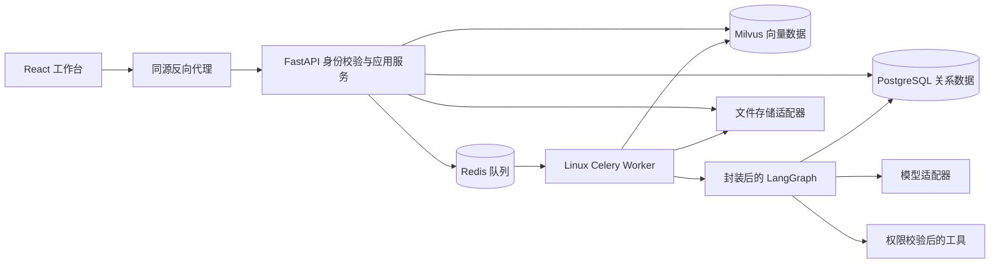
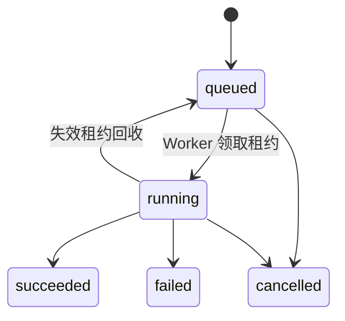

# YugiTalk 架构设计

状态：阶段 0–5 已由用户验收；阶段 6 开发中，整体门槛未通过。向量存储使用 Milvus，聊天与嵌入模型独立配置，生产发布继续按阶段验收。

七步增强 RAG 已实现并通过自动验证，人工验收待确认。`rag/pipeline.py` 在现有任务执行器内编排规则/Fast 路由、并行混合检索、重排、评分和单次纠偏。Milvus 原生 BM25 与 Dense 经 RRF 融合；PostgreSQL 保存实际父子块关系及证据版本。新增迁移 `0008_rag_hierarchy` 已应用于独立阶段六数据库。

RAG 歧义暂停使用 `running → waiting_input → queued`，补充后恢复原 Run 检查点；等待有期限、次数有上限，取消或过期释放预算。恢复和流式输出重新核验权限及来源，后台中断后不会无条件重复已完成检索。实现边界、流程图与受控旧索引升级见 [七步增强 RAG](./ENHANCED_RAG.md)。

## 分层与运行方式

API 是权限和协议边界；领域服务定义状态、预算与工具权限规则。Worker 负责执行，不绕过领域规则。PostgreSQL 是运行状态与工具执行记录的事实来源；Redis 只负责投递及短期缓存。

Milvus 保存向量和检索标量字段，etcd 保存其元数据，MinIO 使用独立 bucket 保存 Milvus 数据。业务资料状态在 PostgreSQL，跨存储索引通过幂等任务与版本校验协调；租户过滤由服务端生成。阶段 4 已实现资料导入、授权检索、引用与删除传播。

上述MinIO为开发及隔离测试存储。正式环境按用户选择连接现有S3服务，原文与Milvus对象分别保存在两个专用Bucket，API与Milvus使用一致端点、Region、寻址方式及可选私有CA。真实服务信息尚缺，外部恢复方案未通过；见 [接入说明](./S3_SETUP.md)。

前端通过同源 API 获取数据；SSE 事件持久化且带序号。反向代理关闭流式缓冲，不能把代理缓存当作事件恢复能力。

## 关键数据模型

| 聚合 | 实体 | 关键约束 |
| --- | --- | --- |
| 身份 | User、Workspace、Membership、Session | Membership 唯一约束；服务端验证空间成员关系 |
| Agent | Agent、AgentVersion | 版本不可变；运行绑定版本快照 |
| 会话 | Conversation、Message | 空间与所有者过滤；消息序号有界分页 |
| 运行 | Run、RunStep、RunEvent、Checkpoint | 状态版本、租约、事件序号唯一；检查点与运行归属关联 |
| 执行 | ToolExecution、RunRetry | 幂等键唯一；工具结果绑定规范化参数哈希 |
| 资料 | KnowledgeBase、Document、Chunk | 索引版本明确；检索前过滤空间权限 |
| 记忆 | UserMemory | 用户主动确认；用户、空间与有效期过滤 |
| 管理 | UsageReservation、UsageRecord、AuditEvent | 原子预算预留；审计脱敏 |

所有需要隔离的实体具有 `workspace_id`，用户私有实体另带 `owner_id`。阶段 2 迁移 `0003_identity` 已创建 users、workspaces、memberships、login_sessions、audit_events，提供成员联合主键、角色约束、外键和会话查询索引。其他业务模型在各自阶段迁移中落实。

密码使用 Argon2id，服务端会话仅保存随机 Cookie 令牌的 HMAC 摘要。每次业务请求实时读取用户状态、会话有效期与成员角色；前端控制不是权限依据。空间成员变更先锁定空间行，再验证权限和最后一个 owner 约束，防止并发降级移除全部所有者。平台管理员可以读取审计元数据，跨空间访问仍需成员授权。

## 四个场景走查

1. **文档问答**：确认空间身份 → 上传与异步解析 → 只查询可用且有权分块 → 模型生成 → 程序核验引用 → 返回可打开的来源。索引失败不加入检索。
2. **资料研究**：创建运行并预留预算 → Worker 获取执行租约 → 模型提议授权只读工具 → 参数与网络目标校验 → 带来源的报告。工具输出不能变更系统权限。
3. **只读工具恢复**：模型提案 → 权限与 Schema 校验 → 提交执行账本结果 → 保存图检查点 → 宕机后复用已经提交的结果。
4. **宕机恢复**：检查点持久化 → Worker 宕机、租约到期 → 新 Worker 接管 → 读取已完成执行记录 → 恢复未完成节点。结果未知的写操作必须先核对，不能直接重放。

## 运行状态

`queued → running → waiting_approval → running → succeeded / failed / cancelled`。

取消与任务完成通过状态版本、租约和事务竞争，只有合法迁移成功。旧工单审批状态只保留兼容关闭逻辑。

## 技术边界

- Celery 正式 Worker 在 Linux 容器运行，Windows 原生不作为支持平台。
- SQLite 检查点只用于阶段 0 本地恢复测试；生产使用 PostgreSQL 检查点。
- 真实外部写入的幂等、预算、身份隔离在后续业务阶段实现；阶段 0 的通过不代表这些功能已验证。
- 单机 Compose 以备份恢复满足基础上线目标，不提供多机高可用承诺。

参见 [架构决策](./adr/0001-runtime-and-worker.md)、[API 契约](./API.md)、[测试计划](./TEST_PLAN.md)。

## 阶段 3 已实现边界

API 负责创建任务、权限与预算预留，Linux Celery Worker 执行 LangGraph 模型／只读工具循环。数据库保存不可变 AgentVersion、本人会话消息、Run、RunEvent 与累计预算。SSE 从数据库读取公开事件，支持有界续传，不暴露内部图状态或模型推理。

Mock、OpenAI 兼容和 Anthropic 分属适配器。实际 Token、保守额度和费用分别表达，未知值不伪造；密钥不进入版本快照、前端或队列消息。阶段 3 的重复消费保护与事件补读不等于阶段 5 的执行恢复。

详细决策、协议来源、事务锁顺序和故障窗口见 [ADR 0003](./adr/0003-agent-runtime.md)。

## 阶段 4 已实现边界

API 保存知识库和文档状态，将仅含文档 ID 与索引版本的任务交给 Worker。Worker 从 S3 读取原文，在隔离进程解析，然后通过独立 Embeddings HTTP 服务编码，写入 Milvus 并更新 PostgreSQL 分块；只有 ready 的当前版本可检索。删除先提交不可检索状态，再异步清理 S3/Milvus。

本地嵌入服务只读加载 Hugging Face BGE-M3 缓存，Windows/Linux 均通过挂载本机路径运行；远程服务器模型复用相同兼容接口，聊天模型独立。嵌入配置参与集合版本哈希，避免维度或模型混用。个人偏好按用户与空间隔离；历史摘要记录来源与截止序号。细节见 [阶段 4 报告](./stages/04-knowledge.md)。

## 阶段 5 已实现边界

运行的 queued 状态是持久投递意图。Scheduler 有界扫描待投递和到期记录，使用 PostgreSQL 行锁协调多个调度器。Worker 领取随机租约令牌，网络阻塞期间续租；应用检查点保存模型边界及每个工具游标，恢复时显式选择图入口。过期 Worker 不能提交状态、来源或终态。

ToolExecution 唯一绑定运行和调用键，记录参数哈希及结果。当前只支持文本统计与报告排版只读工具。工单工具、审批 API 与 UI 已移除；历史 Approval、Ticket 表与旧迁移保留，既有数据不删除。旧版本只在使用时过滤下线工具，旧待审批任务由 Scheduler 结束并释放预算。恢复不重放已提交工具，未完整提交的模型请求可能再次计费；预算只增量结算。

文档索引宕机恢复增加索引版本并从原文重建，阻止旧版本半成品重新可检索。完整设计与外部副作用限制见 [ADR 0005](./adr/0005-reliable-execution.md)，故障证据见 [阶段 5 报告](./stages/05-reliability.md)。

## 阶段6生产边界

独立生产覆盖文件只通过HTTPS前端暴露API，私有网络容纳数据库、队列、向量/对象存储、嵌入与监控。认证指标与手工追踪由 `observability/` 维护；队列只传任务ID与traceparent，不传正文。Prometheus与Jaeger数据同样位于项目目录。跨存储冷备与兼容Schema内镜像回滚取舍见 [ADR0006](./adr/0006-production-operations.md)。阶段6仍有安全与完整评测门槛未通过。
