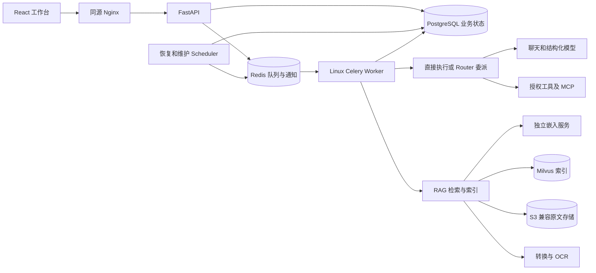
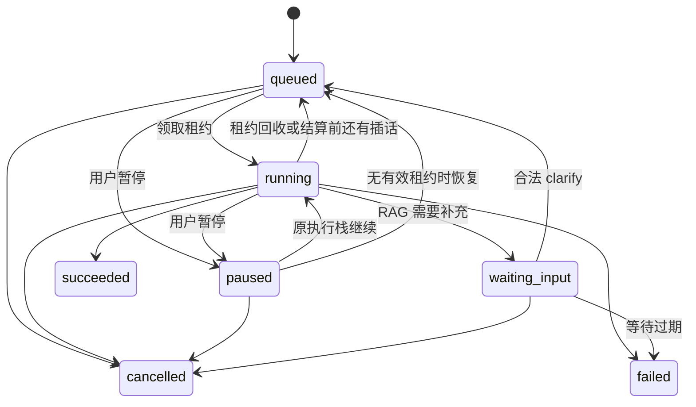

# YugiTalk 当前架构

更新日期：2026 年 11 月 13 日。本文描述现有源码，历史方案见 [需求](REQUIREMENTS.md)、[ADR](adr/) 和 [阶段报告](stages/)。本机部署健康不等于生产安全、真实模型质量或灾难恢复已验收。

## 组件与职责

API 校验身份、归属、参数和并发，事务保存任务后再投递。PostgreSQL 保存消息、运行状态、来源版本、事件、检查点与工具账本，是业务事实来源。Redis 承担投递、限流、缓存和提交后通知，通知不能替代 SQL 中的持久事件。Worker 执行任务，Scheduler 补投排队记录、回收过期租约和处理等待期限。

Milvus 保存 Dense、BM25 及检索字段，etcd 保存其元数据，对象存储保存原文和 Milvus 数据。开发使用 MinIO，正式环境要求见 [S3 接入](S3_SETUP.md)。最终回答证据仍需通过 SQL 归属、状态和版本核验。

## 用户与资源隔离

资源直接归登录用户。`accounts/access.py` 中 `membership()` 是兼容命名，实际判断为 `account_id == user_id` 且用户有效，不再提供组织工作空间和成员共享管理。`/me/workspace` 是旧文件目录读取兼容接口，与已移除的组织空间不同。

| 领域 | 当前实体或状态 |
| --- | --- |
| 身份 | User、LoginSession、注册验证码及审计 |
| 助手与扩展 | Agent、AgentVersion、Skill 和工具版本、MCP 服务器 |
| 对话与执行 | Conversation、Message、Run、RunEvent、Budget、ToolExecution、RunRetry |
| 知识 | KnowledgeBase、Document、父子分块、知识图谱批次 |
| 记忆与研究 | 记忆、偏好、会话摘要、研究项目与交付文件 |

历史 Approval、Ticket 仅保留兼容数据。完整字段见 [数据库结构](DATABASE_SCHEMA.md)，归属迁移见 [USER_OWNERSHIP](USER_OWNERSHIP.md)。当前源码迁移头为 `0027_memory_importance`；操作时仍需核对 `alembic heads` 和运行库版本。

## Agent 执行路径

`tasks/router.py` 在创建 Run 时冻结模型连接、助手版本、工具目录、Skill、资源配置及会话截止序号。

1. 符合短单意图、无 Skill、无 MCP 等条件的任务使用 `run_direct()`，直接执行授权工具并流式回答。
2. 复杂任务及相应配置使用 `run_router()`。主助手只获得委派工具，执行助手继承原助手版本的模型和工具权限，父子共用任务预算、取消和租约。
3. 闭环不保证每次都经过计划和检查：新会话的简单问答可以走直接路径；委派助手按配置执行闭环，旧任务也保留原执行路径。
4. 显式指定知识库的兼容路径先执行 RAG，再进入 Agent；自动 `knowledge_search` 是工具内检索，不能与前置 RAG 混为一条入口。

详见 [完整调用顺序](PROJECT_FLOW.md)、[闭环](AGENT_CLOSED_LOOP.md) 和 [HITL](HITL.md)。

## 状态与恢复

LangGraph 编排有界模型和工具循环，应用通过 `Run.checkpoint` 保存恢复位置。不要将依赖中存在 checkpoint 包表述为当前业务使用其原生持久化。历史 `waiting_approval` 任务由兼容关闭逻辑结束，不是当前逐次工具审批入口。

工具账本记录规范化参数及已提交结果，恢复时复用成功记录；未提交完整结果的模型调用仍可能再次执行和计费。MCP、下载等外部操作还受各自不确定性处理约束，不承诺全链路 exactly once。

## 资料与人工介入

上传先保存原文与 SQL 记录，索引任务传递文档 ID 和版本。转换、分块、嵌入和索引成功后才发布 ready。删除先阻断召回，再异步清理对象和索引；图谱及引用也按原文版本校验。

RAG 澄清保存 `waiting_input` 并释放租约，用户补充后从检索继续；插话把 user 级指令写入原 Run，在后续主助手模型边界合并；普通暂停优先保留原栈和租约。三者不是同一种等待方式。

聊天附件和研究交付分别见 [CHAT_UPLOADS](CHAT_UPLOADS.md)、[DEEP_RESEARCH](DEEP_RESEARCH.md)。旧文件目录界面已移除，后端兼容读取见 [FILE_WORKSPACE](FILE_WORKSPACE.md)。

## 安全和运行边界

- 模型只提出调用，服务端检查白名单、Schema、用户归属、网络目标和凭证绑定，用户插话不能扩大权限。
- 固定系统策略与用户、Skill、记忆和资料保持不同信任层级；结构性防护不等于免疫 Prompt 注入。
- SSE 持久事件按序号续传，通知丢失可回读 SQL；关闭网页不自动取消后台任务。
- 配置更新需要 API、Worker、Scheduler 重新加载环境；`restart` 不更新容器环境。
- 单机 Compose 不提供多机高可用承诺。外部 S3 恢复、真实模型质量和完整生产安全仍需独立验证。

操作入口见 [开发](DEVELOPMENT.md)、[排障](RUNBOOK.md) 和 [生产部署](DEPLOYMENT.md)。
