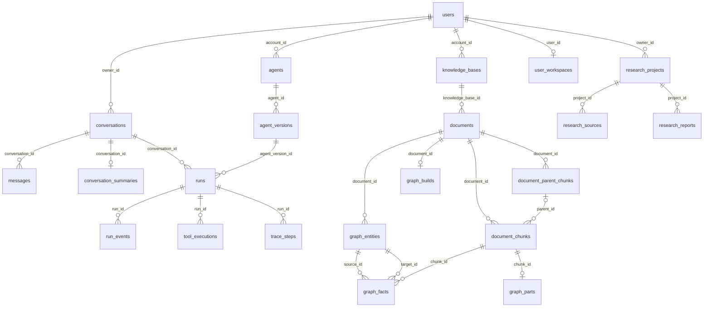

# YugiTalk 数据库表文档

> 更新日期：2026 年 11 月 13 日。依据当前 SQLAlchemy 实体，并补齐至 Alembic `0027_memory_importance`；新增研究和文件目录兼容表按 ORM 声明核对。本文描述代码声明的目标结构，未连接运行数据库核验部署状态。

## 1. 范围与约定

- PostgreSQL 保存 39 张业务表、281 个字段；另有 Alembic 管理表 `alembic_version`。SQLite 用于隔离测试，不是生产迁移目标。
- Milvus 保存向量，S3 兼容对象存储保存原文件，Redis 承担队列等运行职责；这些内容不是本文的 PostgreSQL 业务表。Docling 是解析服务，不额外建立业务表。
- `account_id` 是用户账号标识，外键指向 `users.id`。0015 已将旧 `workspace_id` 改名并移除 `workspaces`、`memberships`；不能按旧空间模型解释。
- UUID 标识采用 `VARCHAR(36)`，不是 PostgreSQL 原生 UUID。时间字段使用 `TIMESTAMP WITH TIME ZONE`，应用生成时间采用 UTC。JSON 字段为 `JSON`，不是 `JSONB`。
- 字段表分别列出 ORM 应用默认值和迁移定义的数据库默认值。应用默认值仅在 ORM 插入时生效，不等价于 SQL `DEFAULT`；“—”表示未声明默认值。
- “可空”指数据库列是否允许 NULL。主键列不可空；复合主键按整组唯一。主键和唯一约束通常由 PostgreSQL 自动建立相应索引，不在普通索引清单中重复列出。
- 未写 `ON DELETE` 的外键采用数据库默认 `NO ACTION`，不表示自动级联删除。状态、JSON 内部结构及跨列归属一致性主要由应用校验，`memories.importance` 已有 1 至 5 的 CHECK 约束，其他业务状态仍需应用校验。
- 索引清单采用迁移创建的名称。0015 改列名没有重命名索引，因此部分 `ix_*_workspace_id` 实际索引的是 `account_id`；以 ORM 元数据建表的测试库可能使用 `ix_*_account_id`。

## 2. 表目录

| 领域 | 表 | 用途 |
| --- | --- | --- |
| 身份与审计 | [users](#users) | 用户 |
| 身份与审计 | [login_sessions](#login_sessions) | 登录会话 |
| 身份与审计 | [email_verifications](#email_verifications) | 邮箱验证 |
| 身份与审计 | [audit_events](#audit_events) | 审计事件 |
| 助手、技能与工具配置 | [agents](#agents) | 助手目录 |
| 助手、技能与工具配置 | [agent_versions](#agent_versions) | 助手版本 |
| 助手、技能与工具配置 | [skills](#skills) | 技能目录 |
| 助手、技能与工具配置 | [skill_versions](#skill_versions) | 技能版本 |
| 助手、技能与工具配置 | [managed_tools](#managed_tools) | 工具目录 |
| 助手、技能与工具配置 | [tool_versions](#tool_versions) | 工具版本 |
| 助手、技能与工具配置 | [tool_submissions](#tool_submissions) | 工具声明审核 |
| 对话与长期记忆 | [conversations](#conversations) | 对话 |
| 对话与长期记忆 | [messages](#messages) | 对话消息 |
| 对话与长期记忆 | [conversation_summaries](#conversation_summaries) | 对话摘要 |
| 对话与长期记忆 | [memory_preferences](#memory_preferences) | 记忆开关 |
| 对话与长期记忆 | [memories](#memories) | 长期记忆 |
| 任务、预算与执行记录 | [runs](#runs) | 任务运行 |
| 任务、预算与执行记录 | [run_events](#run_events) | 任务事件 |
| 任务、预算与执行记录 | [budgets](#budgets) | Token 预算账目 |
| 任务、预算与执行记录 | [tool_executions](#tool_executions) | 工具执行账本 |
| 任务、预算与执行记录 | [run_retries](#run_retries) | 任务重试去重 |
| 任务、预算与执行记录 | [trace_steps](#trace_steps) | 任务步骤追踪 |
| 任务、预算与执行记录 | [approvals](#approvals) | 历史审批 |
| 任务、预算与执行记录 | [tickets](#tickets) | 历史工单 |
| 知识库与知识图谱 | [knowledge_bases](#knowledge_bases) | 知识库 |
| 知识库与知识图谱 | [documents](#documents) | 文档索引状态 |
| 知识库与知识图谱 | [document_parent_chunks](#document_parent_chunks) | 父级原文块 |
| 知识库与知识图谱 | [document_chunks](#document_chunks) | 检索子块 |
| 知识库与知识图谱 | [graph_builds](#graph_builds) | 图谱构建状态 |
| 知识库与知识图谱 | [graph_parts](#graph_parts) | 图谱抽取暂存 |
| 知识库与知识图谱 | [graph_entities](#graph_entities) | 图谱实体 |
| 知识库与知识图谱 | [graph_facts](#graph_facts) | 图谱关系证据 |
| 远程 MCP | [mcp_servers](#mcp_servers) | 用户私有服务器 |
| 远程 MCP | [mcp_server_versions](#mcp_server_versions) | 不可变服务器配置 |
| 远程 MCP | [mcp_credentials](#mcp_credentials) | 加密认证凭证 |
| 新增研究与目录兼容 | [research_projects](#research_projects) | 研究项目 |
| 新增研究与目录兼容 | [research_reports](#research_reports) | 研究报告 |
| 新增研究与目录兼容 | [research_sources](#research_sources) | 研究来源 |
| 新增研究与目录兼容 | [user_workspaces](#user_workspaces) | 旧文件目录读取配置 |

## 3. 主要关系

下图只展示核心业务链路；所有外键以各表字段说明为准。`o|` 表示父记录可以尚无对应的单行子记录。

## 4. 字段、约束与索引

### 身份与审计

#### `users` — 用户

保存用户身份、密码摘要、账号启用状态及平台管理权限。

| 字段 | PostgreSQL 类型 | 可空 | 应用默认值 | 数据库默认值 | 说明与约束 |
| --- | --- | --- | --- | --- | --- |
| `id` | `VARCHAR(36)` | 否 | UUID4 字符串 | — | 记录标识；PK |
| `email` | `VARCHAR(254)` | 否 | — | — | 邮箱地址，原值和 lower(email) 均受唯一性约束 |
| `name` | `VARCHAR(80)` | 否 | — | — | 名称 |
| `password_hash` | `TEXT` | 否 | — | — | 密码哈希摘要 |
| `active` | `BOOLEAN` | 否 | `true` | — | 账号是否启用 |
| `platform_admin` | `BOOLEAN` | 否 | `false` | — | 是否为平台管理员 |
| `username` | `VARCHAR(80)` | 是 | — | — | 可选登录用户名，唯一 |

**唯一约束**：唯一约束（数据库命名）：(email)

**索引（不含主键及 UNIQUE 约束自动索引）**：

- `uq_users_email_normalized`：(lower(email))，唯一索引。
- `uq_users_username`：(username)，唯一索引。

#### `login_sessions` — 登录会话

保存登录令牌摘要及有效期；不保存明文令牌。

| 字段 | PostgreSQL 类型 | 可空 | 应用默认值 | 数据库默认值 | 说明与约束 |
| --- | --- | --- | --- | --- | --- |
| `token_hash` | `VARCHAR(64)` | 否 | — | — | 会话令牌摘要，作为主键；PK |
| `user_id` | `VARCHAR(36)` | 否 | — | — | 用户标识；FK → users.id；ON DELETE CASCADE |
| `expires_at` | `TIMESTAMP WITH TIME ZONE` | 否 | — | — | 有效期截止时间 |
| `development_mode` | `BOOLEAN` | 否 | `false` | `false` | 是否为开发模式会话 |

**唯一约束**：除主键外无单独 UNIQUE 约束；唯一索引见下。

**索引（不含主键及 UNIQUE 约束自动索引）**：

- `ix_login_sessions_expires_at`：(expires_at)，普通索引。
- `ix_login_sessions_user_id`：(user_id)，普通索引。

#### `email_verifications` — 邮箱验证

按邮箱保存验证码摘要、有效期和发送/消费状态；不保存明文验证码。

| 字段 | PostgreSQL 类型 | 可空 | 应用默认值 | 数据库默认值 | 说明与约束 |
| --- | --- | --- | --- | --- | --- |
| `email` | `VARCHAR(254)` | 否 | — | — | 验证邮箱，作为主键；此表不通过外键绑定 users；PK |
| `code_hash` | `VARCHAR(64)` | 否 | — | — | 验证码摘要 |
| `expires_at` | `TIMESTAMP WITH TIME ZONE` | 否 | — | — | 有效期截止时间 |
| `sent_at` | `TIMESTAMP WITH TIME ZONE` | 否 | — | — | 发送时间 |
| `attempts` | `INTEGER` | 否 | `0` | `0` | 执行或验证尝试次数 |
| `delivered` | `BOOLEAN` | 否 | `false` | `false` | 是否已成功投递 |
| `consumed` | `BOOLEAN` | 否 | `false` | `false` | 是否已消费 |

**唯一约束**：除主键外无单独 UNIQUE 约束；唯一索引见下。

**索引（不含主键及 UNIQUE 约束自动索引）**：

无显式索引。

#### `audit_events` — 审计事件

记录操作人、动作及目标标识，不承担完整业务正文存储。

| 字段 | PostgreSQL 类型 | 可空 | 应用默认值 | 数据库默认值 | 说明与约束 |
| --- | --- | --- | --- | --- | --- |
| `id` | `VARCHAR(36)` | 否 | UUID4 字符串 | — | 记录标识；PK |
| `actor_id` | `VARCHAR(36)` | 否 | — | — | 实际操作用户；FK → users.id；ON DELETE NO ACTION |
| `account_id` | `VARCHAR(36)` | 是 | — | — | 事件所属用户账号；全局事件可为空；FK → users.id；ON DELETE NO ACTION |
| `action` | `VARCHAR(60)` | 否 | — | — | 审计动作代码 |
| `target_id` | `VARCHAR(36)` | 是 | — | — | 目标资源标识；无数据库外键 |
| `created_at` | `TIMESTAMP WITH TIME ZONE` | 否 | 当前 UTC 时间 | — | 创建时间 |

**唯一约束**：除主键外无单独 UNIQUE 约束；唯一索引见下。

**索引（不含主键及 UNIQUE 约束自动索引）**：

- `ix_audit_events_actor_id`：(actor_id)，普通索引。
- `ix_audit_events_workspace_id`：(account_id)，普通索引。

### 助手、技能与工具配置

#### `agents` — 助手目录

保存助手名称和用户归属；软删除保留历史版本及任务引用。

| 字段 | PostgreSQL 类型 | 可空 | 应用默认值 | 数据库默认值 | 说明与约束 |
| --- | --- | --- | --- | --- | --- |
| `id` | `VARCHAR(36)` | 否 | UUID4 字符串 | — | 记录标识；PK |
| `account_id` | `VARCHAR(36)` | 否 | — | — | 资源所属用户账号，引用 users.id；FK → users.id；ON DELETE NO ACTION |
| `name` | `VARCHAR(80)` | 否 | — | — | 名称 |
| `deleted` | `BOOLEAN` | 否 | `false` | `false` | 软删除标记 |
| `created_at` | `TIMESTAMP WITH TIME ZONE` | 否 | 当前 UTC 时间 | — | 创建时间 |

**唯一约束**：除主键外无单独 UNIQUE 约束；唯一索引见下。

**索引（不含主键及 UNIQUE 约束自动索引）**：

- `ix_agents_workspace_id`：(account_id)，普通索引。

#### `agent_versions` — 助手版本

发布时冻结助手配置，任务固定引用具体版本。

| 字段 | PostgreSQL 类型 | 可空 | 应用默认值 | 数据库默认值 | 说明与约束 |
| --- | --- | --- | --- | --- | --- |
| `id` | `VARCHAR(36)` | 否 | UUID4 字符串 | — | 记录标识；PK |
| `agent_id` | `VARCHAR(36)` | 否 | — | — | 助手目录标识；FK → agents.id；ON DELETE NO ACTION |
| `number` | `INTEGER` | 否 | — | — | 版本序号 |
| `config` | `JSON` | 否 | — | — | 不可变版本配置 |
| `created_at` | `TIMESTAMP WITH TIME ZONE` | 否 | 当前 UTC 时间 | — | 创建时间 |

**唯一约束**：`uq_agent_version_number`：(agent_id, number)

**索引（不含主键及 UNIQUE 约束自动索引）**：

- `ix_agent_versions_agent_id`：(agent_id)，普通索引。

#### `skills` — 技能目录

保存用户技能的启停、删除和名称唯一性。

| 字段 | PostgreSQL 类型 | 可空 | 应用默认值 | 数据库默认值 | 说明与约束 |
| --- | --- | --- | --- | --- | --- |
| `id` | `VARCHAR(36)` | 否 | UUID4 字符串 | — | 记录标识；PK |
| `account_id` | `VARCHAR(36)` | 否 | — | — | 资源所属用户账号，引用 users.id；FK → users.id；ON DELETE NO ACTION |
| `owner_id` | `VARCHAR(36)` | 否 | — | — | 技能所有者；FK → users.id；ON DELETE NO ACTION |
| `name` | `VARCHAR(64)` | 否 | — | — | 名称 |
| `enabled` | `BOOLEAN` | 否 | `true` | — | 是否启用 |
| `deleted` | `BOOLEAN` | 否 | `false` | — | 软删除标记 |
| `created_at` | `TIMESTAMP WITH TIME ZONE` | 否 | 当前 UTC 时间 | — | 创建时间 |

**唯一约束**：除主键外无单独 UNIQUE 约束；唯一索引见下。

**索引（不含主键及 UNIQUE 约束自动索引）**：

- `ix_skills_owner_id`：(owner_id)，普通索引。
- `ix_skills_workspace_id`：(account_id)，普通索引。
- `uq_skill_workspace_name`：(account_id, name)，唯一索引；条件：`deleted = false`。

#### `skill_versions` — 技能版本

保存不可变的技能说明、指令正文和工具授权清单。

| 字段 | PostgreSQL 类型 | 可空 | 应用默认值 | 数据库默认值 | 说明与约束 |
| --- | --- | --- | --- | --- | --- |
| `id` | `VARCHAR(36)` | 否 | UUID4 字符串 | — | 记录标识；PK |
| `skill_id` | `VARCHAR(36)` | 否 | — | — | 技能目录标识；FK → skills.id；ON DELETE NO ACTION |
| `number` | `INTEGER` | 否 | — | — | 版本序号 |
| `name` | `VARCHAR(64)` | 否 | — | — | 发布时冻结的技能名称 |
| `description` | `VARCHAR(500)` | 否 | — | — | 技能用途说明 |
| `instructions` | `TEXT` | 否 | — | — | 技能指令正文 |
| `allowed_tools` | `JSON` | 否 | — | — | 允许使用的工具名称列表 |
| `content_hash` | `VARCHAR(64)` | 否 | — | — | 内容摘要，用于校验或去重 |
| `created_at` | `TIMESTAMP WITH TIME ZONE` | 否 | 当前 UTC 时间 | — | 创建时间 |

**唯一约束**：除主键外无单独 UNIQUE 约束；唯一索引见下。

**索引（不含主键及 UNIQUE 约束自动索引）**：

- `ix_skill_versions_skill_id`：(skill_id)，普通索引。
- `uq_skill_version_number`：(skill_id, number)，唯一索引。

#### `managed_tools` — 工具目录

保存内置工具启停覆盖及自定义工具身份，历史版本单独存储。

| 字段 | PostgreSQL 类型 | 可空 | 应用默认值 | 数据库默认值 | 说明与约束 |
| --- | --- | --- | --- | --- | --- |
| `id` | `VARCHAR(36)` | 否 | UUID4 字符串 | — | 记录标识；PK |
| `account_id` | `VARCHAR(36)` | 否 | — | — | 资源所属用户账号，引用 users.id；FK → users.id；ON DELETE NO ACTION |
| `owner_id` | `VARCHAR(36)` | 是 | — | — | 工具所有者；历史结构允许为空；FK → users.id；ON DELETE NO ACTION |
| `name` | `VARCHAR(64)` | 否 | — | — | 名称 |
| `builtin` | `BOOLEAN` | 否 | `false` | — | 是否为内置工具 |
| `enabled` | `BOOLEAN` | 否 | `true` | — | 是否启用 |
| `deleted` | `BOOLEAN` | 否 | `false` | — | 软删除标记 |
| `created_at` | `TIMESTAMP WITH TIME ZONE` | 否 | 当前 UTC 时间 | — | 创建时间 |

**唯一约束**：除主键外无单独 UNIQUE 约束；唯一索引见下。

**索引（不含主键及 UNIQUE 约束自动索引）**：

- `ix_managed_tools_owner_id`：(owner_id)，普通索引。
- `ix_managed_tools_workspace_id`：(account_id)，普通索引。
- `uq_managed_tool_name`：(account_id, name)，唯一索引；条件：`deleted = false`。

#### `tool_versions` — 工具版本

冻结 HTTP 查询工具配置和内容摘要，不保存真实凭证。

| 字段 | PostgreSQL 类型 | 可空 | 应用默认值 | 数据库默认值 | 说明与约束 |
| --- | --- | --- | --- | --- | --- |
| `id` | `VARCHAR(36)` | 否 | UUID4 字符串 | — | 记录标识；PK |
| `tool_id` | `VARCHAR(36)` | 否 | — | — | 工具目录标识；FK → managed_tools.id；ON DELETE NO ACTION |
| `number` | `INTEGER` | 否 | — | — | 版本序号 |
| `config` | `JSON` | 否 | — | — | 不可变版本配置 |
| `content_hash` | `VARCHAR(64)` | 否 | — | — | 内容摘要，用于校验或去重 |
| `created_at` | `TIMESTAMP WITH TIME ZONE` | 否 | 当前 UTC 时间 | — | 创建时间 |

**唯一约束**：除主键外无单独 UNIQUE 约束；唯一索引见下。

**索引（不含主键及 UNIQUE 约束自动索引）**：

- `ix_tool_versions_tool_id`：(tool_id)，普通索引。
- `uq_tool_version_number`：(tool_id, number)，唯一索引。

#### `tool_submissions` — 工具声明审核

保存用户提交的工具声明及管理员审核结论；批准后才进入执行目录。

| 字段 | PostgreSQL 类型 | 可空 | 应用默认值 | 数据库默认值 | 说明与约束 |
| --- | --- | --- | --- | --- | --- |
| `id` | `VARCHAR(36)` | 否 | UUID4 字符串 | — | 记录标识；PK |
| `account_id` | `VARCHAR(36)` | 否 | — | — | 资源所属用户账号，引用 users.id；FK → users.id；ON DELETE NO ACTION |
| `submitter_id` | `VARCHAR(36)` | 否 | — | — | 提交用户；FK → users.id；ON DELETE NO ACTION |
| `config` | `JSON` | 否 | — | — | 待审核工具声明快照 |
| `content_hash` | `VARCHAR(64)` | 否 | — | — | 内容摘要，用于校验或去重 |
| `status` | `VARCHAR(16)` | 否 | `pending` | — | 处理状态，见状态说明 |
| `reason` | `VARCHAR(500)` | 否 | `` | — | 审核说明 |
| `reviewer_id` | `VARCHAR(36)` | 是 | — | — | 审核管理员；未审核时为空；FK → users.id；ON DELETE NO ACTION |
| `created_at` | `TIMESTAMP WITH TIME ZONE` | 否 | 当前 UTC 时间 | — | 创建时间 |
| `reviewed_at` | `TIMESTAMP WITH TIME ZONE` | 是 | — | — | 审核时间 |

**唯一约束**：除主键外无单独 UNIQUE 约束；唯一索引见下。

**索引（不含主键及 UNIQUE 约束自动索引）**：

- `ix_tool_submissions_status`：(status)，普通索引。
- `ix_tool_submissions_submitter_id`：(submitter_id)，普通索引。
- `ix_tool_submissions_workspace_id`：(account_id)，普通索引。

### 对话与长期记忆

#### `conversations` — 对话

保存用户拥有的对话及标题。

| 字段 | PostgreSQL 类型 | 可空 | 应用默认值 | 数据库默认值 | 说明与约束 |
| --- | --- | --- | --- | --- | --- |
| `id` | `VARCHAR(36)` | 否 | UUID4 字符串 | — | 记录标识；PK |
| `account_id` | `VARCHAR(36)` | 否 | — | — | 资源所属用户账号，引用 users.id；FK → users.id；ON DELETE NO ACTION |
| `owner_id` | `VARCHAR(36)` | 否 | — | — | 所属用户；FK → users.id；ON DELETE NO ACTION |
| `title` | `VARCHAR(80)` | 否 | — | — | 对话标题 |
| `created_at` | `TIMESTAMP WITH TIME ZONE` | 否 | 当前 UTC 时间 | — | 创建时间 |

**唯一约束**：除主键外无单独 UNIQUE 约束；唯一索引见下。

**索引（不含主键及 UNIQUE 约束自动索引）**：

- `ix_conversations_owner_id`：(owner_id)，普通索引。
- `ix_conversations_workspace_id`：(account_id)，普通索引。

#### `messages` — 对话消息

保存对话内有序消息及答案来源引用。

| 字段 | PostgreSQL 类型 | 可空 | 应用默认值 | 数据库默认值 | 说明与约束 |
| --- | --- | --- | --- | --- | --- |
| `id` | `VARCHAR(36)` | 否 | UUID4 字符串 | — | 记录标识；PK |
| `conversation_id` | `VARCHAR(36)` | 否 | — | — | 对话标识；FK → conversations.id；ON DELETE CASCADE |
| `sequence` | `INTEGER` | 否 | — | — | 对话内递增消息序号 |
| `role` | `VARCHAR(12)` | 否 | — | — | 消息角色，例如 user、assistant |
| `content` | `TEXT` | 否 | — | — | 文本正文 |
| `uploaded_files` | `JSON` | 否 | `[]` | `[]` | 上传附件的文件名、大小、提取正文与截取标记；0026 新增，独立于任务历史保留 |
| `sources` | `JSON` | 否 | `[]` | `[]` | 答案来源引用列表 |
| `created_at` | `TIMESTAMP WITH TIME ZONE` | 否 | 当前 UTC 时间 | — | 创建时间 |

**唯一约束**：`uq_message_sequence`：(conversation_id, sequence)

**索引（不含主键及 UNIQUE 约束自动索引）**：

- `ix_messages_conversation_id`：(conversation_id)，普通索引。

#### `conversation_summaries` — 对话摘要

每个对话最多一行摘要，记录覆盖的消息范围。

| 字段 | PostgreSQL 类型 | 可空 | 应用默认值 | 数据库默认值 | 说明与约束 |
| --- | --- | --- | --- | --- | --- |
| `conversation_id` | `VARCHAR(36)` | 否 | — | — | 对话标识；PK；FK → conversations.id；ON DELETE CASCADE |
| `upto_sequence` | `INTEGER` | 否 | — | — | 摘要已覆盖到的消息序号 |
| `content` | `TEXT` | 否 | — | — | 文本正文 |
| `source_ids` | `JSON` | 否 | — | — | 摘要关联的来源标识列表 |
| `strategy` | `VARCHAR(40)` | 否 | `bounded-extractive-v1` | — | 摘要生成策略版本 |

**唯一约束**：除主键外无单独 UNIQUE 约束；唯一索引见下。

**索引（不含主键及 UNIQUE 约束自动索引）**：

无显式索引。

#### `memory_preferences` — 记忆开关

按账号与用户组合保存长期记忆开关；当前应用按个人账号使用。

| 字段 | PostgreSQL 类型 | 可空 | 应用默认值 | 数据库默认值 | 说明与约束 |
| --- | --- | --- | --- | --- | --- |
| `account_id` | `VARCHAR(36)` | 否 | — | — | 资源所属用户账号，引用 users.id；复合 PK 成员；FK → users.id；ON DELETE NO ACTION |
| `user_id` | `VARCHAR(36)` | 否 | — | — | 用户标识；复合 PK 成员；FK → users.id；ON DELETE NO ACTION |
| `enabled` | `BOOLEAN` | 否 | `true` | — | 是否启用 |

**唯一约束**：除主键外无单独 UNIQUE 约束；唯一索引见下。

**索引（不含主键及 UNIQUE 约束自动索引）**：

无显式索引。

#### `memories` — 长期记忆

保存用户主动确认的偏好记忆。

| 字段 | PostgreSQL 类型 | 可空 | 应用默认值 | 数据库默认值 | 说明与约束 |
| --- | --- | --- | --- | --- | --- |
| `id` | `VARCHAR(36)` | 否 | UUID4 字符串 | — | 记录标识；PK |
| `account_id` | `VARCHAR(36)` | 否 | — | — | 资源所属用户账号，引用 users.id；FK → users.id；ON DELETE NO ACTION |
| `user_id` | `VARCHAR(36)` | 否 | — | — | 用户标识；FK → users.id；ON DELETE NO ACTION |
| `content` | `VARCHAR(1000)` | 否 | — | — | 用户确认的记忆正文，最多 1000 字符 |
| `importance` | `INTEGER` | 否 | 3 | 3 | 用户设置的重要等级，CHECK `ck_memory_importance` 限制为 1～5 |
| `created_at` | `TIMESTAMP WITH TIME ZONE` | 否 | 当前 UTC 时间 | — | 创建时间 |

**唯一约束**：除主键外无单独 UNIQUE 约束；唯一索引见下。

**索引（不含主键及 UNIQUE 约束自动索引）**：

- `ix_memories_user_id`：(user_id)，普通索引。
- `ix_memories_workspace_id`：(account_id)，普通索引。

### 任务、预算与执行记录

#### `runs` — 任务运行

保存一次助手执行的输入、配置快照、预算、状态、恢复检查点与 Worker 租约。

| 字段 | PostgreSQL 类型 | 可空 | 应用默认值 | 数据库默认值 | 说明与约束 |
| --- | --- | --- | --- | --- | --- |
| `id` | `VARCHAR(36)` | 否 | UUID4 字符串 | — | 记录标识；PK |
| `account_id` | `VARCHAR(36)` | 否 | — | — | 资源所属用户账号，引用 users.id；FK → users.id；ON DELETE NO ACTION |
| `owner_id` | `VARCHAR(36)` | 否 | — | — | 所属用户；FK → users.id；ON DELETE NO ACTION |
| `conversation_id` | `VARCHAR(36)` | 否 | — | — | 对话标识；FK → conversations.id；ON DELETE NO ACTION |
| `agent_version_id` | `VARCHAR(36)` | 否 | — | — | 固定引用的助手版本；FK → agent_versions.id；ON DELETE NO ACTION |
| `snapshot` | `JSON` | 否 | — | — | 本次任务所用助手和资源版本的冻结快照 |
| `idempotency_key` | `VARCHAR(128)` | 否 | — | — | 用户范围内的请求幂等键 |
| `request_hash` | `VARCHAR(64)` | 否 | — | — | 请求内容摘要，防止同键更换内容 |
| `prompt` | `TEXT` | 否 | — | — | 用户任务输入正文 |
| `status` | `VARCHAR(16)` | 否 | `queued` | — | 处理状态，见状态说明 |
| `cancel_requested` | `BOOLEAN` | 否 | `false` | — | 是否请求取消 |
| `reserved_tokens` | `INTEGER` | 否 | — | — | 本次任务预留额度 |
| `charged_tokens` | `INTEGER` | 否 | `0` | — | 保守计费消耗 |
| `input_tokens` | `INTEGER` | 是 | — | — | 供应商报告的输入 Token 数；未知时为空 |
| `output_tokens` | `INTEGER` | 是 | — | — | 供应商报告的输出 Token 数；未知时为空 |
| `error_code` | `VARCHAR(50)` | 是 | — | — | 可公开的错误代码 |
| `event_sequence` | `INTEGER` | 否 | `0` | — | 当前已分配的事件序号 |
| `started_at` | `TIMESTAMP WITH TIME ZONE` | 是 | — | — | 开始时间 |
| `created_at` | `TIMESTAMP WITH TIME ZONE` | 否 | 当前 UTC 时间 | — | 创建时间 |
| `finished_at` | `TIMESTAMP WITH TIME ZONE` | 是 | — | — | 结束时间 |
| `lease_token` | `VARCHAR(36)` | 是 | — | — | Worker 租约令牌，防止旧执行者写入 |
| `lease_until` | `TIMESTAMP WITH TIME ZONE` | 是 | — | — | 租约到期时间 |
| `checkpoint` | `JSON` | 否 | `{}` | `{}` | 服务端恢复状态，含节点与中间状态 |
| `state_version` | `INTEGER` | 否 | `0` | `0` | 持久状态版本 |
| `attempts` | `INTEGER` | 否 | `0` | `0` | 执行或验证尝试次数 |
| `active_seconds` | `INTEGER` | 否 | `0` | `0` | 累计实际运行秒数，不含排队和等待输入 |
| `slice_started_at` | `TIMESTAMP WITH TIME ZONE` | 是 | — | — | 本次运行时间片起点 |
| `settled_tokens` | `INTEGER` | 否 | `0` | `0` | 已结算消耗，避免恢复后重复计费 |
| `last_dispatched_at` | `TIMESTAMP WITH TIME ZONE` | 是 | — | — | 最近一次投递队列的时间 |

**唯一约束**：`uq_run_idempotency`：(owner_id, idempotency_key)

**索引（不含主键及 UNIQUE 约束自动索引）**：

- `ix_runs_conversation_id`：(conversation_id)，普通索引。
- `ix_runs_owner_id`：(owner_id)，普通索引。
- `ix_runs_status`：(status)，普通索引。
- `ix_runs_workspace_id`：(account_id)，普通索引。

#### `run_events` — 任务事件

保存可公开的递增任务事件，支持断线后按序号继续读取。

| 字段 | PostgreSQL 类型 | 可空 | 应用默认值 | 数据库默认值 | 说明与约束 |
| --- | --- | --- | --- | --- | --- |
| `id` | `VARCHAR(36)` | 否 | UUID4 字符串 | — | 记录标识；PK |
| `run_id` | `VARCHAR(36)` | 否 | — | — | 任务运行标识；FK → runs.id；ON DELETE CASCADE |
| `sequence` | `INTEGER` | 否 | — | — | 任务内递增事件序号 |
| `kind` | `VARCHAR(30)` | 否 | — | — | 事件类型 |
| `payload` | `JSON` | 否 | — | — | 对外任务事件数据 |
| `created_at` | `TIMESTAMP WITH TIME ZONE` | 否 | 当前 UTC 时间 | — | 创建时间 |

**唯一约束**：`uq_run_event_sequence`：(run_id, sequence)

**索引（不含主键及 UNIQUE 约束自动索引）**：

- `ix_run_events_run_id`：(run_id)，普通索引。

#### `budgets` — Token 预算账目

保存逻辑预算桶的预留和已消费 Token，不以外键绑定用户。

| 字段 | PostgreSQL 类型 | 可空 | 应用默认值 | 数据库默认值 | 说明与约束 |
| --- | --- | --- | --- | --- | --- |
| `key` | `VARCHAR(80)` | 否 | — | — | 预算桶键：space:<account_id> 或 user:<owner_id>；space 前缀为兼容命名；PK |
| `reserved` | `INTEGER` | 否 | `0` | — | 当前预留 Token |
| `spent` | `INTEGER` | 否 | `0` | — | 累计已消费 Token |

**唯一约束**：除主键外无单独 UNIQUE 约束；唯一索引见下。

**索引（不含主键及 UNIQUE 约束自动索引）**：

无显式索引。

#### `tool_executions` — 工具执行账本

按任务和调用键去重，记录参数摘要、执行状态及结果，供恢复判断。

| 字段 | PostgreSQL 类型 | 可空 | 应用默认值 | 数据库默认值 | 说明与约束 |
| --- | --- | --- | --- | --- | --- |
| `id` | `VARCHAR(36)` | 否 | UUID4 字符串 | — | 记录标识；PK |
| `run_id` | `VARCHAR(36)` | 否 | — | — | 任务运行标识；FK → runs.id；ON DELETE CASCADE |
| `call_key` | `VARCHAR(180)` | 否 | — | — | 任务内的稳定工具调用键 |
| `tool` | `VARCHAR(80)` | 否 | — | — | 工具名称 |
| `arguments` | `JSON` | 否 | — | — | 执行参数 JSON |
| `argument_hash` | `VARCHAR(64)` | 否 | — | — | 工具参数摘要 |
| `status` | `VARCHAR(20)` | 否 | `proposed` | — | 处理状态，见状态说明 |
| `result` | `JSON` | 否 | `{}` | — | 执行结果 JSON |

**唯一约束**：`uq_tool_run_call`：(run_id, call_key)

**索引（不含主键及 UNIQUE 约束自动索引）**：

- `ix_tool_executions_run_id`：(run_id)，普通索引。

#### `run_retries` — 任务重试去重

将用户重试幂等键绑定任务，避免同一次重试重复预留额度。

| 字段 | PostgreSQL 类型 | 可空 | 应用默认值 | 数据库默认值 | 说明与约束 |
| --- | --- | --- | --- | --- | --- |
| `id` | `VARCHAR(36)` | 否 | UUID4 字符串 | — | 记录标识；PK |
| `run_id` | `VARCHAR(36)` | 否 | — | — | 任务运行标识；FK → runs.id；ON DELETE CASCADE |
| `owner_id` | `VARCHAR(36)` | 否 | — | — | 所属用户；FK → users.id；ON DELETE NO ACTION |
| `key` | `VARCHAR(128)` | 否 | — | — | 用户范围内的重试幂等键 |

**唯一约束**：`uq_retry_owner_key`：(owner_id, key)

**索引（不含主键及 UNIQUE 约束自动索引）**：

- `ix_run_retries_run_id`：(run_id)，普通索引。

#### `trace_steps` — 任务步骤追踪

保存步骤开始、结束、耗时和供应商用量；不保存提示词、记忆正文或工具参数。

| 字段 | PostgreSQL 类型 | 可空 | 应用默认值 | 数据库默认值 | 说明与约束 |
| --- | --- | --- | --- | --- | --- |
| `id` | `VARCHAR(36)` | 否 | UUID4 字符串 | — | 记录标识；PK |
| `run_id` | `VARCHAR(36)` | 否 | — | — | 任务运行标识；FK → runs.id；ON DELETE CASCADE |
| `parent_id` | `VARCHAR(36)` | 是 | — | — | 父步骤逻辑标识；没有自引用外键 |
| `attempt` | `INTEGER` | 否 | — | — | 所属任务执行尝试轮次 |
| `iteration` | `INTEGER` | 是 | — | — | 代理循环迭代号 |
| `kind` | `VARCHAR(20)` | 否 | — | — | 步骤类别 |
| `name` | `VARCHAR(100)` | 否 | — | — | 步骤名称 |
| `status` | `VARCHAR(20)` | 否 | `running` | — | 处理状态，见状态说明 |
| `started_at` | `TIMESTAMP WITH TIME ZONE` | 否 | 当前 UTC 时间 | — | 开始时间 |
| `finished_at` | `TIMESTAMP WITH TIME ZONE` | 是 | — | — | 结束时间 |
| `duration_ms` | `INTEGER` | 是 | — | — | 耗时，单位毫秒 |
| `input_tokens` | `INTEGER` | 是 | — | — | 供应商报告的输入 Token 数；未知时为空 |
| `output_tokens` | `INTEGER` | 是 | — | — | 供应商报告的输出 Token 数；未知时为空 |
| `details` | `JSON` | 否 | `{}` | — | 有限的步骤元数据 |

**唯一约束**：除主键外无单独 UNIQUE 约束；唯一索引见下。

**索引（不含主键及 UNIQUE 约束自动索引）**：

- `ix_trace_steps_run_id`：(run_id)，普通索引。

#### `approvals` — 历史审批

仅保留历史审批数据，当前功能不提供审批操作。

| 字段 | PostgreSQL 类型 | 可空 | 应用默认值 | 数据库默认值 | 说明与约束 |
| --- | --- | --- | --- | --- | --- |
| `id` | `VARCHAR(36)` | 否 | UUID4 字符串 | — | 记录标识；PK |
| `execution_id` | `VARCHAR(36)` | 否 | — | — | 工具执行账本标识；FK → tool_executions.id；ON DELETE CASCADE |
| `owner_id` | `VARCHAR(36)` | 否 | — | — | 所属用户；FK → users.id；ON DELETE NO ACTION |
| `status` | `VARCHAR(16)` | 否 | `pending` | — | 处理状态，见状态说明 |
| `argument_hash` | `VARCHAR(64)` | 否 | — | — | 工具参数摘要 |
| `expires_at` | `TIMESTAMP WITH TIME ZONE` | 否 | — | — | 有效期截止时间 |
| `decided_at` | `TIMESTAMP WITH TIME ZONE` | 是 | — | — | 审批决定时间 |

**唯一约束**：唯一约束（数据库命名）：(execution_id)

**索引（不含主键及 UNIQUE 约束自动索引）**：

- `ix_approvals_owner_id`：(owner_id)，普通索引。

#### `tickets` — 历史工单

仅保留历史工单数据，当前功能不提供工单创建。

| 字段 | PostgreSQL 类型 | 可空 | 应用默认值 | 数据库默认值 | 说明与约束 |
| --- | --- | --- | --- | --- | --- |
| `id` | `VARCHAR(36)` | 否 | UUID4 字符串 | — | 记录标识；PK |
| `account_id` | `VARCHAR(36)` | 否 | — | — | 资源所属用户账号，引用 users.id；FK → users.id；ON DELETE NO ACTION |
| `owner_id` | `VARCHAR(36)` | 否 | — | — | 所属用户；FK → users.id；ON DELETE NO ACTION |
| `execution_id` | `VARCHAR(36)` | 是 | — | — | 工具执行账本标识；FK → tool_executions.id；ON DELETE SET NULL |
| `title` | `VARCHAR(120)` | 否 | — | — | 工单标题 |
| `body` | `TEXT` | 否 | — | — | 工单正文 |
| `created_at` | `TIMESTAMP WITH TIME ZONE` | 否 | 当前 UTC 时间 | — | 创建时间 |

**唯一约束**：唯一约束（数据库命名）：(execution_id)

**索引（不含主键及 UNIQUE 约束自动索引）**：

- `ix_tickets_owner_id`：(owner_id)，普通索引。
- `ix_tickets_workspace_id`：(account_id)，普通索引。

### 知识库与知识图谱

#### `knowledge_bases` — 知识库

保存用户知识库；删除先设置标记，资料清理由后台处理。

| 字段 | PostgreSQL 类型 | 可空 | 应用默认值 | 数据库默认值 | 说明与约束 |
| --- | --- | --- | --- | --- | --- |
| `id` | `VARCHAR(36)` | 否 | UUID4 字符串 | — | 记录标识；PK |
| `account_id` | `VARCHAR(36)` | 否 | — | — | 资源所属用户账号，引用 users.id；FK → users.id；ON DELETE NO ACTION |
| `name` | `VARCHAR(80)` | 否 | — | — | 名称 |
| `deleted` | `BOOLEAN` | 否 | `false` | `false` | 软删除标记 |
| `created_at` | `TIMESTAMP WITH TIME ZONE` | 否 | 当前 UTC 时间 | — | 创建时间 |

**唯一约束**：除主键外无单独 UNIQUE 约束；唯一索引见下。

**索引（不含主键及 UNIQUE 约束自动索引）**：

- `ix_knowledge_bases_workspace_id`：(account_id)，普通索引。

#### `documents` — 文档索引状态

关系数据库中的文档索引权威记录，原始文件位于对象存储、向量位于 Milvus。

| 字段 | PostgreSQL 类型 | 可空 | 应用默认值 | 数据库默认值 | 说明与约束 |
| --- | --- | --- | --- | --- | --- |
| `id` | `VARCHAR(36)` | 否 | UUID4 字符串 | — | 记录标识；PK |
| `knowledge_base_id` | `VARCHAR(36)` | 否 | — | — | 所属知识库；FK → knowledge_bases.id；ON DELETE NO ACTION |
| `account_id` | `VARCHAR(36)` | 否 | — | — | 资源所属用户账号，引用 users.id；FK → users.id；ON DELETE NO ACTION |
| `filename` | `VARCHAR(160)` | 否 | — | — | 原始文件名 |
| `content_hash` | `VARCHAR(64)` | 否 | — | — | 原文件内容摘要，同知识库内唯一 |
| `object_key` | `VARCHAR(200)` | 否 | — | — | 原文件在对象存储中的键 |
| `size` | `INTEGER` | 否 | — | — | 原文件大小，单位字节 |
| `status` | `VARCHAR(16)` | 否 | `queued` | — | 处理状态，见状态说明 |
| `error_code` | `VARCHAR(50)` | 是 | — | — | 可公开的错误代码 |
| `progress` | `JSON` | 否 | `{}` | `{}` | 导入阶段及分块计数等进度数据 |
| `index_version` | `INTEGER` | 否 | `1` | — | 文档索引代次，用于隔离重新索引及旧任务写入 |
| `embedding_version` | `VARCHAR(64)` | 否 | — | — | 嵌入模型语义版本 |
| `chunk_strategy` | `VARCHAR(40)` | 否 | `paragraph-700-overlap100-v1` | — | 分块策略版本 |
| `collection_name` | `VARCHAR(64)` | 否 | — | — | Milvus 向量集合名 |
| `lease_token` | `VARCHAR(36)` | 是 | — | — | Worker 租约令牌，防止旧执行者写入 |
| `lease_until` | `TIMESTAMP WITH TIME ZONE` | 是 | — | — | 租约到期时间 |
| `attempts` | `INTEGER` | 否 | `0` | `0` | 执行或验证尝试次数 |
| `last_dispatched_at` | `TIMESTAMP WITH TIME ZONE` | 是 | — | — | 最近一次投递队列的时间 |
| `created_at` | `TIMESTAMP WITH TIME ZONE` | 否 | 当前 UTC 时间 | — | 创建时间 |

**唯一约束**：`uq_document_hash`：(knowledge_base_id, content_hash)

**索引（不含主键及 UNIQUE 约束自动索引）**：

- `ix_documents_knowledge_base_id`：(knowledge_base_id)，普通索引。
- `ix_documents_status`：(status)，普通索引。
- `ix_documents_workspace_id`：(account_id)，普通索引。

#### `document_parent_chunks` — 父级原文块

保存可核验的父级原文范围；父块只存 SQL，不重复写入向量索引。

| 字段 | PostgreSQL 类型 | 可空 | 应用默认值 | 数据库默认值 | 说明与约束 |
| --- | --- | --- | --- | --- | --- |
| `id` | `VARCHAR(36)` | 否 | — | — | 父块标识，由索引流程提供，无 ORM 默认值；PK |
| `document_id` | `VARCHAR(36)` | 否 | — | — | 文档标识；FK → documents.id；ON DELETE NO ACTION |
| `index_version` | `INTEGER` | 否 | — | — | 文档索引代次，用于隔离重新索引及旧任务写入 |
| `ordinal` | `INTEGER` | 否 | — | — | 文档内分块顺序号 |
| `page` | `INTEGER` | 是 | — | — | 来源页码；无页码时为空 |
| `content` | `TEXT` | 否 | — | — | 文本正文 |
| `child_count` | `INTEGER` | 否 | — | — | 父块包含的子块数量 |

**唯一约束**：除主键外无单独 UNIQUE 约束；唯一索引见下。

**索引（不含主键及 UNIQUE 约束自动索引）**：

- `ix_document_parent_chunks_document_id`：(document_id)，普通索引。

#### `document_chunks` — 检索子块

保存检索子块及原文位置，供来源引用、索引版本校验和图谱构建使用。

| 字段 | PostgreSQL 类型 | 可空 | 应用默认值 | 数据库默认值 | 说明与约束 |
| --- | --- | --- | --- | --- | --- |
| `id` | `VARCHAR(36)` | 否 | UUID4 字符串 | — | 记录标识；PK |
| `document_id` | `VARCHAR(36)` | 否 | — | — | 文档标识；FK → documents.id；ON DELETE NO ACTION |
| `ordinal` | `INTEGER` | 否 | — | — | 文档内分块顺序号 |
| `page` | `INTEGER` | 是 | — | — | 来源页码；无页码时为空 |
| `content` | `TEXT` | 否 | — | — | 文本正文 |
| `index_version` | `INTEGER` | 否 | — | — | 文档索引代次，用于隔离重新索引及旧任务写入 |
| `parent_id` | `VARCHAR(36)` | 是 | — | — | 所属父块，旧索引或无层级索引时可为空；FK → document_parent_chunks.id；ON DELETE NO ACTION |

**唯一约束**：除主键外无单独 UNIQUE 约束；唯一索引见下。

**索引（不含主键及 UNIQUE 约束自动索引）**：

- `ix_document_chunks_document_id`：(document_id)，普通索引。
- `ix_document_chunks_parent_id`：(parent_id)，普通索引。

#### `graph_builds` — 图谱构建状态

每份文档最多一行构建记录，保存本轮索引代次、构建状态与恢复租约。

| 字段 | PostgreSQL 类型 | 可空 | 应用默认值 | 数据库默认值 | 说明与约束 |
| --- | --- | --- | --- | --- | --- |
| `document_id` | `VARCHAR(36)` | 否 | — | — | 文档标识；PK；FK → documents.id；ON DELETE NO ACTION |
| `index_version` | `INTEGER` | 否 | — | — | 文档索引代次，用于隔离重新索引及旧任务写入 |
| `status` | `VARCHAR(16)` | 否 | `queued` | — | 处理状态，见状态说明 |
| `error_code` | `VARCHAR(50)` | 是 | — | — | 可公开的错误代码 |
| `token` | `VARCHAR(36)` | 是 | — | — | 本轮图谱构建租约令牌 |
| `lease_until` | `TIMESTAMP WITH TIME ZONE` | 是 | — | — | 租约到期时间 |
| `dispatched_at` | `TIMESTAMP WITH TIME ZONE` | 是 | — | — | 图谱构建最近投递时间 |
| `attempts` | `INTEGER` | 否 | `0` | — | 执行或验证尝试次数 |
| `mode` | `VARCHAR(16)` | 否 | `model` | — | 构建模式：model 或 mock |

**唯一约束**：除主键外无单独 UNIQUE 约束；唯一索引见下。

**索引（不含主键及 UNIQUE 约束自动索引）**：

- `ix_graph_builds_status`：(status)，普通索引。

#### `graph_parts` — 图谱抽取暂存

暂存本轮已校验的分块抽取；全部完成前不参与图谱检索。

| 字段 | PostgreSQL 类型 | 可空 | 应用默认值 | 数据库默认值 | 说明与约束 |
| --- | --- | --- | --- | --- | --- |
| `chunk_id` | `VARCHAR(36)` | 否 | — | — | 来源检索子块标识；PK；FK → document_chunks.id；ON DELETE NO ACTION |
| `document_id` | `VARCHAR(36)` | 否 | — | — | 文档标识；FK → documents.id；ON DELETE NO ACTION |
| `data` | `JSON` | 否 | — | — | 已校验的分块实体与关系抽取结果 JSON |

**唯一约束**：除主键外无单独 UNIQUE 约束；唯一索引见下。

**索引（不含主键及 UNIQUE 约束自动索引）**：

- `ix_graph_parts_document_id`：(document_id)，普通索引。

#### `graph_entities` — 图谱实体

保存文档内归一的实体；跨文档同名不自动合并身份。

| 字段 | PostgreSQL 类型 | 可空 | 应用默认值 | 数据库默认值 | 说明与约束 |
| --- | --- | --- | --- | --- | --- |
| `id` | `VARCHAR(36)` | 否 | UUID4 字符串 | — | 记录标识；PK |
| `document_id` | `VARCHAR(36)` | 否 | — | — | 文档标识；FK → documents.id；ON DELETE NO ACTION |
| `index_version` | `INTEGER` | 否 | — | — | 文档索引代次，用于隔离重新索引及旧任务写入 |
| `name` | `VARCHAR(120)` | 否 | — | — | 实体规范名称 |
| `kind` | `VARCHAR(20)` | 否 | — | — | 实体类型，见状态与取值说明 |
| `aliases` | `JSON` | 否 | `[]` | — | 实体别名列表 |

**唯一约束**：除主键外无单独 UNIQUE 约束；唯一索引见下。

**索引（不含主键及 UNIQUE 约束自动索引）**：

- `ix_graph_entities_document_id`：(document_id)，普通索引。

#### `graph_facts` — 图谱关系证据

每行保存一条关系的一份原文证据，可由多个文档分别支持同一关系。

| 字段 | PostgreSQL 类型 | 可空 | 应用默认值 | 数据库默认值 | 说明与约束 |
| --- | --- | --- | --- | --- | --- |
| `id` | `VARCHAR(36)` | 否 | UUID4 字符串 | — | 记录标识；PK |
| `document_id` | `VARCHAR(36)` | 否 | — | — | 文档标识；FK → documents.id；ON DELETE NO ACTION |
| `index_version` | `INTEGER` | 否 | — | — | 文档索引代次，用于隔离重新索引及旧任务写入 |
| `source_id` | `VARCHAR(36)` | 否 | — | — | 关系起点实体；FK → graph_entities.id；ON DELETE NO ACTION |
| `target_id` | `VARCHAR(36)` | 否 | — | — | 关系终点实体；FK → graph_entities.id；ON DELETE NO ACTION |
| `relation` | `VARCHAR(20)` | 否 | — | — | 关系类型，见状态与取值说明 |
| `chunk_id` | `VARCHAR(36)` | 否 | — | — | 来源检索子块标识；FK → document_chunks.id；ON DELETE NO ACTION |
| `quote` | `TEXT` | 否 | — | — | 支持该关系的连续原文证据 |

**唯一约束**：除主键外无单独 UNIQUE 约束；唯一索引见下。

**索引（不含主键及 UNIQUE 约束自动索引）**：

- `ix_graph_facts_chunk_id`：(chunk_id)，普通索引。
- `ix_graph_facts_document_id`：(document_id)，普通索引。
- `ix_graph_facts_source_id`：(source_id)，普通索引。
- `ix_graph_facts_target_id`：(target_id)，普通索引。

### 远程 MCP

#### `mcp_servers` — 用户私有服务器

| 字段 | PostgreSQL 类型 | 可空 | 应用默认值 | 数据库默认值 | 说明与约束 |
| --- | --- | --- | --- | --- | --- |
| `id` | `VARCHAR(36)` | 否 | UUID4 字符串 | — | PK |
| `account_id` | `VARCHAR(36)` | 否 | — | — | FK → users.id；ON DELETE NO ACTION |
| `name` | `VARCHAR(80)` | 否 | — | — | 显示名称 |
| `enabled` | `BOOLEAN` | 否 | `true` | — | 是否允许连接与调用 |
| `deleted` | `BOOLEAN` | 否 | `false` | — | 软删除标记 |
| `revision` | `INTEGER` | 否 | `1` | — | 当前配置代次；变更后旧任务失效 |
| `created_at` | `TIMESTAMP WITH TIME ZONE` | 否 | 当前 UTC 时间 | — | 创建时间 |

索引：`ix_mcp_servers_account_id`，普通索引 `(account_id)`。除主键外无唯一约束。

#### `mcp_server_versions` — 不可变服务器配置

| 字段 | PostgreSQL 类型 | 可空 | 应用默认值 | 数据库默认值 | 说明与约束 |
| --- | --- | --- | --- | --- | --- |
| `id` | `VARCHAR(36)` | 否 | UUID4 字符串 | — | PK |
| `server_id` | `VARCHAR(36)` | 否 | — | — | FK → mcp_servers.id；ON DELETE NO ACTION |
| `config` | `JSON` | 否 | — | — | URL、transport、revision；不保存 Token |

索引：`ix_mcp_server_versions_server_id`，普通索引 `(server_id)`。版本与代次对应由应用维护，无额外数据库唯一约束。

#### `mcp_credentials` — 加密认证凭证

| 字段 | PostgreSQL 类型 | 可空 | 应用默认值 | 数据库默认值 | 说明与约束 |
| --- | --- | --- | --- | --- | --- |
| `server_id` | `VARCHAR(36)` | 否 | — | — | PK；FK → mcp_servers.id；ON DELETE NO ACTION |
| `encrypted` | `TEXT` | 否 | — | — | 绑定服务器及用户的加密 Bearer Token，不向客户端或模型回显 |

除主键外无额外索引或唯一约束。删除服务器时应用删除凭证；密钥和历史配置不进入工具执行快照。

### 研究与文件目录兼容

下列表按当前 ORM 声明列出应用默认值与约束；数据库默认值及已有部署的实际结构仍需核对对应迁移，不能由 ORM 默认值推断 SQL DEFAULT。

#### `research_projects` — 研究项目

| 字段 | PostgreSQL 类型 | 可空 | 应用默认值 | 说明与约束 |
| --- | --- | --- | --- | --- |
| `id` | `VARCHAR(36)` | 否 | UUID4 字符串 | 记录标识；PK |
| `owner_id` | `VARCHAR(36)` | 否 | — | 所属用户；FK → users.id |
| `title` | `VARCHAR(160)` | 否 | — | 项目标题 |
| `question` | `TEXT` | 否 | — | 研究问题 |
| `options` | `JSON` | 否 | 空对象 | 研究选项 JSON |
| `state` | `JSON` | 否 | 空对象 | 研究进度与 Run 关联 JSON |
| `created_at` | `TIMESTAMP WITH TIME ZONE` | 否 | 当前 UTC 时间 | 创建时间 |

**索引**：`ix_research_projects_owner_id`：owner_id。

**唯一约束**：除主键外无额外 UNIQUE。

#### `research_reports` — 研究报告

| 字段 | PostgreSQL 类型 | 可空 | 应用默认值 | 说明与约束 |
| --- | --- | --- | --- | --- |
| `id` | `VARCHAR(36)` | 否 | UUID4 字符串 | 记录标识；PK |
| `project_id` | `VARCHAR(36)` | 否 | — | 所属研究项目；FK → research_projects.id |
| `run_id` | `VARCHAR(36)` | 否 | — | 关联任务标识，当前 ORM 未声明外键 |
| `version` | `INTEGER` | 否 | — | 报告版本 |
| `markdown` | `TEXT` | 否 | — | 报告正文 |
| `data` | `JSON` | 否 | — | 来源或报告元数据 JSON |
| `created_at` | `TIMESTAMP WITH TIME ZONE` | 否 | 当前 UTC 时间 | 创建时间 |

**索引**：`ix_research_reports_project_id`：project_id。

**唯一约束**：`uq_research_report_run`：project_id, run_id。

#### `research_sources` — 研究来源

| 字段 | PostgreSQL 类型 | 可空 | 应用默认值 | 说明与约束 |
| --- | --- | --- | --- | --- |
| `id` | `VARCHAR(36)` | 否 | UUID4 字符串 | 记录标识；PK |
| `project_id` | `VARCHAR(36)` | 否 | — | 所属研究项目；FK → research_projects.id |
| `identity` | `VARCHAR(64)` | 否 | — | 来源去重身份 |
| `data` | `JSON` | 否 | — | 来源或报告元数据 JSON |
| `created_at` | `TIMESTAMP WITH TIME ZONE` | 否 | 当前 UTC 时间 | 创建时间 |

**索引**：`ix_research_sources_project_id`：project_id。

**唯一约束**：`uq_research_source`：project_id, identity。

#### `user_workspaces` — 旧文件目录读取配置

| 字段 | PostgreSQL 类型 | 可空 | 应用默认值 | 说明与约束 |
| --- | --- | --- | --- | --- |
| `user_id` | `VARCHAR(36)` | 否 | — | 所属用户，单用户一条配置；PK；FK → users.id；ON DELETE CASCADE |
| `directory` | `VARCHAR(2048)` | 否 | `""` | 选定目录标识 |
| `enabled` | `BOOLEAN` | 否 | `false` | 是否启用读取 |
| `revision` | `INTEGER` | 否 | `1` | 授权配置版本 |
| `source` | `VARCHAR(16)` | 否 | `"server"` | 目录来源模式 |
| `files` | `JSON` | 否 | 空对象 | 导入文件清单 JSON |
| `imported_at` | `TIMESTAMP WITH TIME ZONE` | 是 | — | 导入时间 |

**索引**：除主键外无 ORM 声明的普通索引。

**唯一约束**：除主键外无额外 UNIQUE。

此表保存旧文件目录读取兼容配置，不是组织空间或成员表；当前附件入口见 [CHAT_UPLOADS](CHAT_UPLOADS.md)。

## 5. 状态与关键业务约束

| 字段 | 当前取值或规则 |
| --- | --- |
| `runs.status` | 排队 `queued`、执行 `running`、暂停 `paused`、等待补充 `waiting_input`、成功 `succeeded`、失败 `failed`、取消 `cancelled`；恢复代码仍兼容历史 `waiting_approval`。 |
| `documents.status` | `queued`、`parsing`、`indexing`、`ready`、`failed`、`deleting`、`deleted`；清理完成后保留 `deleted` 墓碑记录。 |
| `graph_builds.status` | `queued`、`building`、`ready`、`failed`。构建失败不会改变普通文档索引的可用状态。 |
| `graph_builds.mode` | `model` 或测试用 `mock`。 |
| `tool_submissions.status` | `pending`、`approved`、`rejected`。 |
| `graph_entities.kind` | `person`、`organization`、`system`、`product`、`concept`。 |
| `graph_facts.relation` | `负责`、`属于`、`依赖`、`使用`、`关联`。 |
| `graph_facts.quote` | 应用要求为来源分块内可核验的连续原文；外键本身不验证证据正文或端点文档归属。 |
| `skills`、`managed_tools` 名称 | 仅对 `deleted = false` 的同账号资源要求唯一；删除后可复用名称。 |
| `documents` 内容去重 | `(knowledge_base_id, content_hash)` 唯一，范围是单个知识库。 |
| 任务幂等 | `(owner_id, idempotency_key)` 唯一，另由 `request_hash` 检查请求内容是否一致。 |
| 任务重试幂等 | `(owner_id, key)` 唯一，映射到 `run_id`。 |
| 工具执行去重 | `(run_id, call_key)` 唯一。 |
| 消息及任务事件顺序 | 分别使用 `(conversation_id, sequence)` 和 `(run_id, sequence)` 唯一约束。 |

这些字符串取值来自当前应用代码，不是数据库 ENUM 或 CHECK；数据库列长度也不等价于完整业务校验。JSON 字段仅约束为合法 JSON，版本快照及引用内容的字段定义见对应服务和接口契约。

## 6. 生命周期与存储边界

1. 助手、技能及工具以目录表保存身份，以版本表保存不可变配置。助手/技能/工具删除采用软删除，历史任务仍能引用版本；不能据 `deleted` 标记直接删除所有关联记录。
2. 知识库删除先标记 `knowledge_bases.deleted`，文档进入 `deleting`，后台清理对象存储、向量及分块/图谱数据，文档记录改为 `deleted` 墓碑。文档、分块和图谱外键未配置级联删除，需按应用清理顺序执行。
3. 文档重新索引增加 `index_version`；查询和图谱发布校验代次，避免旧 Worker 发布过期结果。`embedding_version` 表示向量语义版本，`collection_name` 指定 Milvus 集合，不可混为一谈。
4. 图谱先将各分块抽取结果写入 `graph_parts`，完成并校验后原子发布实体和关系。暂存记录以 `chunk_id` 为主键；代次通过当前文档及构建状态约束，不另存 `index_version`。
5. `runs.checkpoint` 是当前任务恢复记录所在列；当前业务模型没有单独的 LangGraph checkpoint 表。租约令牌和到期时间限制重复执行者写入，预算结算字段防止重复计费。
6. 数据库显式级联范围包括：用户 → 登录会话；对话 → 消息/摘要；任务 → 事件/执行账本/重试记录/追踪步骤；执行账本 → 历史审批。执行账本删除时历史工单的 `execution_id` 置空。其他关系以各表外键定义为准。

## 7. 迁移管理与核对

### Alembic 管理表

| 表 | 字段 | 类型 | 约束 | 用途 |
| --- | --- | --- | --- | --- |
| `alembic_version` | `version_num` | `VARCHAR(32)` | 主键、非空 | Alembic 默认版本表，记录已应用的迁移版本；不在业务 ORM 元数据中。 |

当前迁移为单链，目标头为 `0027_memory_importance`；实际数据库应用到了哪个版本，以该库的 Alembic 记录为准。

| 迁移区间 | 结构变化 |
| --- | --- |
| 0001–0002 | 历史向量扩展初始化及切换 Milvus；当前不在 PostgreSQL 建业务向量表。 |
| 0003–0005 | 身份、审计、助手、任务、对话、预算、知识库及记忆基础表。 |
| 0006–0008 | 文档进度、任务与文档租约、执行账本和恢复、父子分块。 |
| 0009–0013 | 技能版本、工具目录及版本、邮箱验证、工具提交审核和个人工具归属。 |
| 0014–0015 | 旧空间删除标记；随后将资源归属迁移到用户并移除空间及成员表。 |
| 0016–0017 | 任务步骤追踪与文档知识图谱。 |
| 0018–0019 | 助手及知识库软删除标记。 |
| 0020 | 图谱分块抽取暂存表。 |
| 0021 | 用户私有 MCP 服务器、配置版本及加密凭证。 |
| 0022–0026 | 大文档容量、深度研究、用户文件空间、文件导入及会话附件独立保留。 |
| 0027 | 记忆重要等级，旧数据回填 3，数据库限制为 1～5。 |

0015 包含 PostgreSQL 数据检查和归属转换，不能仅靠离线 DDL 或 SQLite 重放验证；该迁移明确不支持自动降级。本文核对了模型与迁移声明的表名、字段、PostgreSQL 类型、可空性及主键，并按迁移整理默认值与索引名称，未执行真实数据迁移。

### 代码入口

- 实体统一注册：[model_registry.py](../backend/app/core/model_registry.py)。
- 身份与审计：[identity/models.py](../backend/app/identity/models.py)、[audit/models.py](../backend/app/audit/models.py)。
- 助手、技能与工具：[agents/models.py](../backend/app/agents/models.py)、[skills/models.py](../backend/app/skills/models.py)、[tools/models.py](../backend/app/tools/models.py)。
- 对话与记忆：[chat/models.py](../backend/app/chat/models.py)、[memory/models.py](../backend/app/memory/models.py)。
- 任务与账本：[tasks/models.py](../backend/app/tasks/models.py)、[ledger_models.py](../backend/app/tasks/ledger_models.py)、[trace_models.py](../backend/app/observability/trace_models.py)。
- 知识与图谱：[rag/models.py](../backend/app/rag/models.py)、[graph_models.py](../backend/app/rag/graph_models.py)。
- 版本迁移：[migrations/versions](../backend/migrations/versions)。
- MCP：[tools/mcp/models.py](../backend/app/tools/mcp/models.py)、[使用说明](MCP.md)。
- 架构与操作：[ARCHITECTURE.md](ARCHITECTURE.md)、[KNOWLEDGE_GRAPH.md](KNOWLEDGE_GRAPH.md)、[USER_OWNERSHIP.md](USER_OWNERSHIP.md)。

后续新增迁移或字段时，应同步更新表目录、字段约束、索引及本文迁移头。
