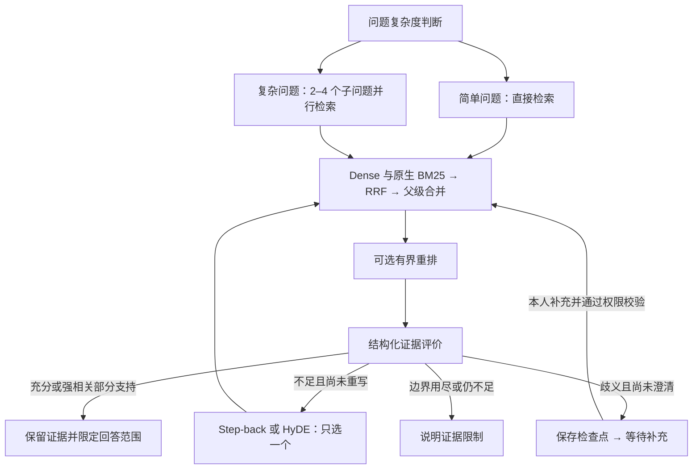

# 七步增强 RAG 实现与配置

更新日期：2026 年 11 月 13 日。本文维护当前检索编排和参数；历史升级与验收记录已移至 [归档](archive/ENHANCED_RAG_VALIDATION.md)。生产发布、真实模型质量和外部恢复需独立验证。

参考本地 `E:\Code\SuperMew-main` 的检索编排、证据、重排与 Milvus 实现思路；代码按 YugiTalk 的用户资源归属、任务租约、预算和数据版本独立实现。核心代码统一在 `backend/app/rag/`，类、方法及具名函数提供中文说明。

## 流程与代码入口

| 步骤 | 实现 | 入口与边界 |
| --- | --- | --- |
| 1. 复杂度 | 默认本地规则；可配置 Fast 模型 | `pipeline.py`、`contracts.py`；模型计划必须满足严格结构 |
| 2. 分解与并行 | 简单一次；复杂 2–4 个不同子问题 | `retrieval.py`；并发可控，任何检索失败取消并等待同组请求结束 |
| 3. 混合召回 | BGE-M3 Dense + Milvus 原生 BM25，中文 jieba 分析器；RRF 融合 | `embeddings.py`、`retrieval.py`；分数按名次融合，父级合并使用 PostgreSQL 的真实父子关系；外部命中在 SQL 中再次授权与 materialize |
| 4. 重排 | 可选 HTTP 重排，默认关闭 | `rerank.py`；候选、字符、时间有上限；超时或熔断沿用融合结果；权限失效与取消不能被降级吞掉 |
| 5. Grader | 相关性、可回答性、歧义、route 四项严格校验 | `model.py`、`contracts.py`；真实模型模式使用当前模型或配置的 Grader；Mock 仅为明确标记的离线规则演示 |
| 6. 单次纠偏 | Step-back 或 HyDE；最多一次重写、一次复评 | `pipeline.py`；HyDE 仅作检索查询，不能成为证据；有候选但证据不足时纠偏；空证据直接结束 |
| 7. 合成与恢复 | 去重证据，正文隐藏来源索引，来源卡片保留 `E-…` 身份 | `retrieval.py`、`resume.py`；身份绑定用户归属、知识库、文档及索引版本；同一 Run 检查点恢复 |

合成复用现有 Agent 流式生成器。来源预览从数据库原文读取；父级合并的引用展示父级原文。公开流程只展示阶段、调用状态和简短计数，不展示模型内部推理。

## 默认配置与边界

配置模板位于根目录 `.env.example`、`.env.production.example`，本轮没有改写你的私有 `.env` 或模型密钥。Docker Compose 的开发与生产后端服务均接收以下配置。

| 配置 | 默认 | 含义 |
| --- | --- | --- |
| `RAG_TIMEOUT_SECONDS` | 60 | 一次 RAG 执行的总截止时间；等待人工补充不占用执行切片 |
| `RAG_PARALLEL_QUERIES` | 4 | 并行查询最多 4 个，每个查询同时召回 Dense 与 BM25 |
| `RAG_FAST_MODEL` | 空 | 默认本地规则；填写后复杂问题可调用同一供应商下的 Fast 模型 |
| `RAG_GRADER_MODEL` | 空 | 非 Mock 模式默认使用当前聊天模型判断证据 |
| `RAG_FAST_API_KEY` | 空 | 规划、改写和图谱抽取的独立密钥；空时沿用 `MODEL_API_KEY` |
| `RAG_GRADER_API_KEY` | 空 | 证据评判的独立密钥；空时沿用 `MODEL_API_KEY` |
| `RAG_CANDIDATE_LIMIT` | 24 | 单路候选上限 |
| `RAG_CONTEXT_CHARACTERS` | 5000 | 证据总字符上限；普通问题通常 5 条，列表问题可保留最多 20 条，仍受总预算限制 |
| `RAG_MERGE_RATIO` | 0.5 | 父级所含子块覆盖率；至少命中两个子块才合并 |
| `RAG_HITL_TTL_SECONDS` | 1800 | 一次澄清等待期限；超时终止并释放预留预算 |
| `RAG_RERANK_URL` / `MODEL` / `API_KEY` | 空 | 可选重排服务；密钥仅保存在后端私有环境配置 |
| `RAG_RERANK_TIMEOUT_SECONDS` | 3 | 重排截止时间，不能超过 RAG 剩余时间 |
| `RAG_RERANK_MAX_CHARACTERS` | 12000 | 重排候选总字符上限；单条最多 2000，问题最多 1000 |
| `RAG_RERANK_FAILURE_THRESHOLD` | 3 | 连续失败后熔断 |
| `RAG_RERANK_COOLDOWN_SECONDS` | 30 | 熔断冷却后允许一次探测 |

重排接口采用 `query`、`documents`、`model` 请求和 `results[index,relevance_score]` 响应；返回索引必须唯一且完整，分数必须有限。熔断器作用于各 Worker 进程，不是跨服务器共享状态。正式环境外部模型与重排必须使用 HTTPS。

配置 Fast、Grader 模型或角色专用密钥时，使用部署的 MODEL_PROVIDER、MODEL_BASE_URL 与对应角色密钥（未设置时使用服务器默认模型密钥）；仅配置角色密钥时使用服务器默认模型名称。角色模型和专用密钥均为空时，沿用当前助手的模型连接。角色密钥使用 SecretStr 保存，不进入冻结的任务配置或公开结果。修改私有 `.env` 后需重新创建 API、Worker 和 Scheduler；代码版本更新还需重新构建后端镜像。

真实模型的计划、评分和重写也计入当前任务预算；达到次数或预算边界时不会继续无限调用。选择知识库后，空检索、评分无相关知识或一次纠错后证据仍不足，统一回复 **“没有相关知识”**，不调用模型生成通用知识答案，也不展示无效来源。空检索直接结束，不调用远端评分或改写；有候选但证据不足时仍保留最多一次重写、一次复评。服务故障显示中文错误提示，不能冒充“没有相关知识”。每次澄清恢复重新检查本人资源权限、文档状态、版本和预算；一次任务最多澄清一次，总评分次数最多两次。

结构化模型调用仅对网络中断、限流和服务端临时故障按 `MODEL_MAX_RETRIES` 有界重试，所有尝试与退避共享原截止时间，每次尝试复核权限并预留保守成本。鉴权和格式错误不自动重试；未知执行异常只记录任务编号、异常类型与代码位置，不记录异常正文或用户资料。

本地或服务器部署均继续使用现有 Embedding HTTP 服务；默认模型仍为已有 Hugging Face 缓存的 BGE-M3（1024 维）。本轮没有移动或下载模型，业务持久数据继续存放项目 `data/` 下，正式外部 S3 按既定方案独立配置。

## 自动知识工具与兼容路径

新对话的执行助手可调用 knowledge_search，简单任务直接执行，复杂任务由 Router 委派；显式 knowledge_base_id 的旧客户端先在任务执行器中运行 RAG。自动工具发生歧义时返回 needs_clarification，不直接挂起父 Run；显式路径通过 waiting_input 等待补充。细节统一见 [HITL](HITL.md)。

## 证据覆盖和回答约束

`EvidenceGrade` 区分相关性、可回答性和歧义。强相关、部分支持且无歧义会被程序路由到 partial_answer，保留真实来源并明确缺口；模型建议不是最终路由。资料缺失不能一律要求用户澄清。无有效证据不能编造引用，HyDE 只作检索词。

`agents/subagents.py` 回传 coverage 与来源；`answer_policy.py` 合并证据包，某个空库不能删除其他库已有命中。`validate_references()` 在生成后检查证据身份，已公开但最终校验失败的部分正文仍不算通过引用校验。

有证据的普通回答上限最多 2048 Token，部分支持、无证据或收尾时最多 1024，并尊重助手配置中更小的值；控制模型仍遵守各自结构化契约。内部 rag_evidence 元数据在模型协议发送前移除。

## 并行和任务内复用

直接执行助手首轮获得当前用户的有界知识库目录，更多项目通过分页工具获取。不同知识库的独立查询可以并行；同一任务内相同查询可复用已完成记录。命中前仍核对归属及文档版本，不跨任务或用户共享证据，Trace 以 reused 标记复用且不伪造新用量。

新证据数量和已有查询提示用于指导只补查明确缺口，不因次数或证据条数撤销工具权限。历史 max_tool_calls 仅为兼容字段，实际仍受模型步骤、超时、重复检查、权限和上下文约束。

## 源码与验收入口

阅读顺序：`rag/contracts.py` → `pipeline.py` → `retrieval.py` → `agents/subagents.py` → `answer_policy.py` → `agents/graph.py`。事件分批和续传见 [OBSERVABILITY](OBSERVABILITY.md)，流程总览见 [PROJECT_FLOW](PROJECT_FLOW.md)。

离线回归见 `test_enhanced_rag.py`、`test_answer_boundaries.py`、`test_subagents.py`、`test_search_parallel_cache.py` 和 `test_steering.py`。真实模型、索引及业务数据上的验收需独立执行，不能从历史 18443 测试记录推断现在的容器状态。检索测量口径见 [评测目录](evaluation/README.md)。
