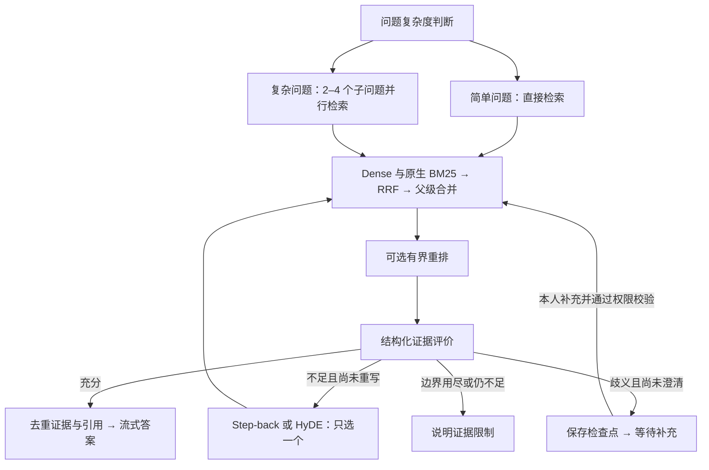

# 七步增强 RAG：实现与验收

2026-10-11：七步流程已接入现有知识库对话，自动验证通过，本轮人工验收待确认。阶段 6 的正式服务器、外部 S3、安全漏洞处置和真实模型质量门槛仍单独保留，不能据此宣布正式上线。

参考本地 `E:\Code\SuperMew-main` 的检索编排、证据、重排与 Milvus 实现思路；代码按 YugiTalk 的空间权限、任务租约、预算和数据版本独立实现。核心代码统一在 `backend/app/rag/`，类、方法及具名函数提供中文说明。

## 流程与代码入口



| 步骤 | 实现 | 入口与边界 |
| --- | --- | --- |
| 1. 复杂度 | 默认本地规则；可配置 Fast 模型 | `pipeline.py`、`contracts.py`；模型计划必须满足严格结构 |
| 2. 分解与并行 | 简单一次；复杂 2–4 个不同子问题 | `retrieval.py`；并发可控，任何检索失败取消并等待同组请求结束 |
| 3. 混合召回 | BGE-M3 Dense + Milvus 原生 BM25，中文 jieba 分析器；RRF 融合 | `embeddings.py`、`retrieval.py`；分数按名次融合，父级合并使用 PostgreSQL 的真实父子关系 |
| 4. 重排 | 可选 HTTP 重排，默认关闭 | `rerank.py`；候选、字符、时间有上限；超时或熔断沿用融合结果；权限失效与取消不能被降级吞掉 |
| 5. Grader | 相关性、可回答性、歧义、route 四项严格校验 | `model.py`、`contracts.py`；真实模型模式使用当前模型或配置的 Grader；Mock 仅为明确标记的离线规则演示 |
| 6. 单次纠偏 | Step-back 或 HyDE；最多一次重写、一次复评 | `pipeline.py`；HyDE 仅作检索查询，不能成为证据；空召回也可进入一次纠偏 |
| 7. 合成与恢复 | 去重证据，正文隐藏来源索引，来源卡片保留 `E-…` 身份 | `retrieval.py`、`resume.py`；身份绑定空间、知识库、文档及索引版本；同一 Run 检查点恢复 |

合成复用现有 Agent 流式生成器。来源预览从数据库原文读取；父级合并的引用展示父级原文。公开流程只展示阶段、调用状态和简短计数，不展示模型内部推理。

## 默认配置与边界

配置模板位于根目录 `.env.example`、`.env.production.example`，本轮没有改写你的私有 `.env` 或模型密钥。Docker Compose 的开发与生产后端服务均接收以下配置。

| 配置 | 默认 | 含义 |
| --- | --- | --- |
| `RAG_TIMEOUT_SECONDS` | 60 | 一次 RAG 执行的总截止时间；等待人工补充不占用执行切片 |
| `RAG_PARALLEL_QUERIES` | 4 | 并行查询最多 4 个，每个查询同时召回 Dense 与 BM25 |
| `RAG_FAST_MODEL` | 空 | 默认本地规则；填写后复杂问题可调用同一供应商下的 Fast 模型 |
| `RAG_GRADER_MODEL` | 空 | 非 Mock 模式默认使用当前聊天模型判断证据 |
| `RAG_FAST_API_KEY` | 空 | 规划、改写和图谱抽取的独立密钥；空时沿用 `MODEL_API_KEY` |
| `RAG_GRADER_API_KEY` | 空 | 证据评判的独立密钥；空时沿用 `MODEL_API_KEY` |
| `RAG_CANDIDATE_LIMIT` | 24 | 单路候选上限 |
| `RAG_CONTEXT_CHARACTERS` | 5000 | 证据总字符上限，最终最多 5 条来源 |
| `RAG_MERGE_RATIO` | 0.5 | 父级所含子块覆盖率；至少命中两个子块才合并 |
| `RAG_HITL_TTL_SECONDS` | 1800 | 一次澄清等待期限；超时终止并释放预留预算 |
| `RAG_RERANK_URL` / `MODEL` / `API_KEY` | 空 | 可选重排服务；密钥仅保存在后端私有环境配置 |
| `RAG_RERANK_TIMEOUT_SECONDS` | 3 | 重排截止时间，不能超过 RAG 剩余时间 |
| `RAG_RERANK_MAX_CHARACTERS` | 12000 | 重排候选总字符上限；单条最多 2000，问题最多 1000 |
| `RAG_RERANK_FAILURE_THRESHOLD` | 3 | 连续失败后熔断 |
| `RAG_RERANK_COOLDOWN_SECONDS` | 30 | 熔断冷却后允许一次探测 |

重排接口采用 `query`、`documents`、`model` 请求和 `results[index,relevance_score]` 响应；返回索引必须唯一且完整，分数必须有限。熔断器作用于各 Worker 进程，不是跨服务器共享状态。正式环境外部模型与重排必须使用 HTTPS。

Fast、Grader 的独立密钥仍使用统一的 `MODEL_PROVIDER` 与 `MODEL_BASE_URL`，不代表可单独选择供应商地址。角色密钥使用 SecretStr 保存，不进入冻结的任务配置或公开结果。修改私有 `.env` 后需重新创建 API、Worker 和 Scheduler；代码版本更新还需重新构建后端镜像。

真实模型的计划、评分和重写也计入当前任务预算；达到次数或预算边界时不会继续无限调用。选择知识库后，空检索、评分无相关知识或一次纠错后证据仍不足，统一回复 **“没有相关知识”**，不调用模型生成通用知识答案，也不展示无效来源。空检索直接结束，不调用远端评分或改写；有候选但证据不足时仍保留最多一次重写、一次复评。服务故障显示中文错误提示，不能冒充“没有相关知识”。每次澄清恢复重新检查本人、空间成员、文档状态、版本和预算；一次任务最多澄清一次，总评分次数最多两次。

结构化模型调用仅对网络中断、限流和服务端临时故障按 `MODEL_MAX_RETRIES` 有界重试，所有尝试与退避共享原截止时间，每次尝试复核权限并预留保守成本。鉴权和格式错误不自动重试；未知执行异常只记录任务编号、异常类型与代码位置，不记录异常正文或用户资料。

本地或服务器部署均继续使用现有 Embedding HTTP 服务；默认模型仍为已有 Hugging Face 缓存的 BGE-M3（1024 维）。本轮没有移动或下载模型，业务持久数据继续存放项目 `data/` 下，正式外部 S3 按既定方案独立配置。

## 数据迁移与已有资料

新增关系库迁移 `0008_rag_hierarchy`：父分块表与子分块的父级引用，不改写已有资料。隔离阶段六数据库已升级到此版本；开发数据库本轮没有升级，也没有替换开发容器。

新上传资料自动写入带原生 BM25 的版本化混合集合。旧稠密集合继续可查，流程记录 `legacy_dense_documents`，不会把它伪装成原生 BM25。分析器、字段和父级策略参与集合版本；发现不匹配结构会报错，禁止静默降级。

旧资料可显式升级：在能够连接开发依赖的项目环境执行下列命令，将示例 UUID 替换为指定资料 ID。默认只查看；`--apply` 才写入新集合。服务器使用其私有环境变量及对应网络连接，不能照搬本机地址。

```powershell
backend/.venv/Scripts/python.exe scripts/rebuild-rag-index.py --document "资料UUID"
backend/.venv/Scripts/python.exe scripts/rebuild-rag-index.py --document "资料UUID" --apply
```

重建复用已保存的同版本向量，不重新下载或生成 Embedding；校验候选完整性后原子切换资料集合指针。失败时保留已发布旧索引。单次限 1000 个分块，不自动批量迁移全部资料，旧集合暂保留以便核对。索引迁移前应备份业务数据；本轮隔离数据库迁移前的备份位于 `data/stage6-production/backups/enhanced-rag-*.dump`。

## 自动验证结果

| 验证 | 本轮结果 | 证据 |
| --- | --- | --- |
| 后端全量回归 | 184 通过、3 跳过；跳过项为需独立阶段零 Worker 的历史测试 | [测试报告](./stages/artifacts/enhanced-rag-tests.xml) |
| 七步针对性测试 | 23 项通过，覆盖并行取消、截止时间、合并、版本权限、重写上限、熔断、澄清幂等及重建失败回退 | `backend/tests/test_enhanced_rag.py` |
| 真实存储集成 | BGE-M3 1024 维、Milvus 2.5.27；原生 BM25 命中、混合并行、父级合并、旧索引升级、删除隔离通过 | [集成报告](./stages/artifacts/enhanced-rag-integration.json) |
| 浏览器 | 同一 Run 暂停、重载后打开历史、补充恢复、答案引用、原文核验、删除测试资料 | [浏览器报告](./stages/artifacts/enhanced-rag-ui.json) |
| 付费调用 | 0 次 | 集成使用离线规则，浏览器使用独立模型协议替身；不是正式模型质量评测 |

前端单元测试、构建、类型检查、代码风格和中文说明检查也纳入本轮验证。Milvus 2.5.14 的开发栈尚未在本轮重启验证，不扩大本轮 2.5.27 的集成结论。

可复现命令（从项目根目录执行）：

```powershell
$env:PYTHONUTF8='1'
backend/.venv/Scripts/python.exe -m pytest -c backend/pyproject.toml backend/tests/test_enhanced_rag.py -q -p no:cacheprovider --basetemp .cache/pytest-enhanced-rag
# 需隔离阶段六服务已运行；脚本初始化专用测试账号，完成后取消任务并删除测试资料。
backend/.venv/Scripts/python.exe scripts/run-enhanced-rag-ui.py
```

真实存储探针仅允许隔离阶段六配置，禁止在业务环境批量写测试资料：

```powershell
Get-Content -Raw -Encoding UTF8 scripts/check-enhanced-rag.py | docker compose --env-file .cache/stage6-production.env -f docker-compose.yml -f docker-compose.prod.yml -f docker-compose.stage6-test.yml -p yugitalk-stage6 exec -T api python -u -
```

## 你现在可以这样验收

2026-10-11 开发修复追加验收：当前 **http://127.0.0.1:8080** 已更新为“无证据固定拒答”版本。选择空知识库，问“你知道薛定谔的猫吗”，应只看到“没有相关知识”，任务正常完成且无来源；刷新后从历史打开仍显示相同结果。无关资料与纠错后仍不足由后端回归验证。开发浏览器验收使用独立身份与空库，没有上传业务资料，没有追加真实模型调用；报告见 [空库页面验收](./stages/artifacts/rag-no-knowledge-ui.json)。

评分故障修复全量结果为后端 208 通过、3 跳过，前端 24 通过；针对性回归 40 项通过。经用户明确授权，曾对原失败任务做一次有界 DeepSeek 评分诊断，返回 `no_knowledge`，原任务未修改；历史异常缺少类型日志，不能据此确定原失败原因。本轮随后均使用离线传输替身或空库测试。正式隔离入口 18443 仍运行上一组镜像，本次只更新开发栈，以下七步历史验收记录不扩展为本轮生产复验。

1. 打开当前独立验收入口 **https://localhost:18443**。本机测试证书、测试账号与私有密码位置见 [部署说明](./DEPLOYMENT.md)；此入口使用协议替身，开发入口 8080 本轮未启动。
2. 创建知识库，上传包含“Milvus 保存 BGE-M3 向量，PostgreSQL 保存资料元数据”的 TXT 或 Markdown。等待导入完成，确认文件出现在右侧且流程重置。
3. 在对话框选择这个知识库，问“Milvus 保存什么？”；确认流程简短显示检索、证据核对和答案，正文不出现 `[S1]`、`[S2]`；展开“检索来源”，点击文件名查看原文及 `E-…` 来源身份。生成中与重新打开历史消息时均隐藏索引。
4. 问“比较 Milvus 和 PostgreSQL 的职责，以及它们如何配合。”；确认流程进入复杂问题处理。协议替身答案内容固定，算法分支和计数以自动测试轨迹为准。
5. 问“它的 Milvus 用途是什么？”；独立替身会触发澄清。刷新页面后从左侧打开该会话，补充“指的是 Milvus，它保存 BGE-M3 向量。”；确认继续同一任务，任务记录不多出一个新 Run。
6. 删除测试资料，再检索原内容；确认删除文件不再显示、旧来源不能继续被当作当前证据。需要验证次数、熔断、越权和恢复等边界时运行自动测试。

通过以上步骤后可确认“七步增强 RAG 本轮人工验收通过”。这项确认独立于阶段 6 的正式上线验收；后续仍需在真实模型上运行版本化质量样例，比较命中、引用准确性、耗时与成本。
