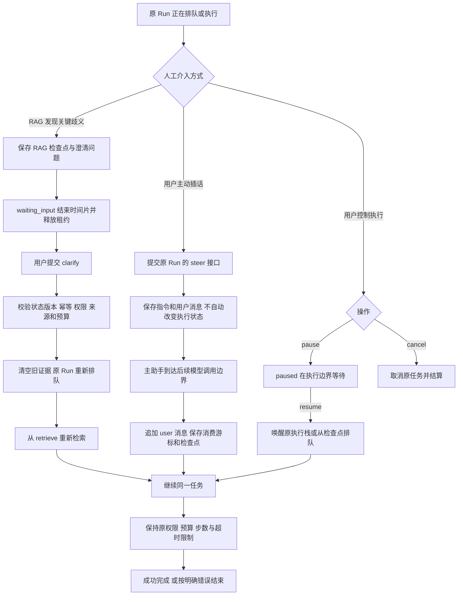
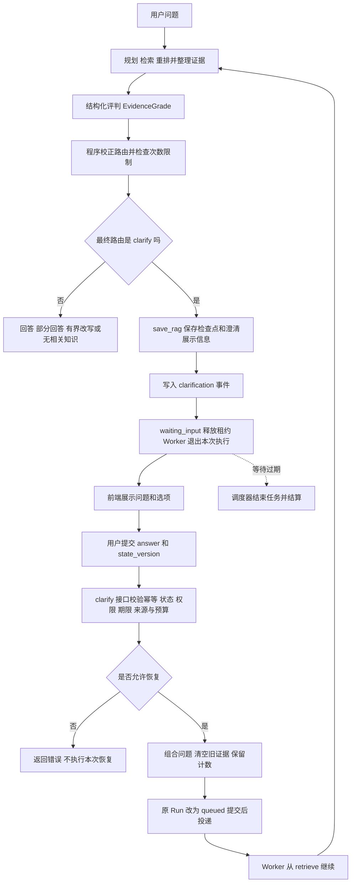
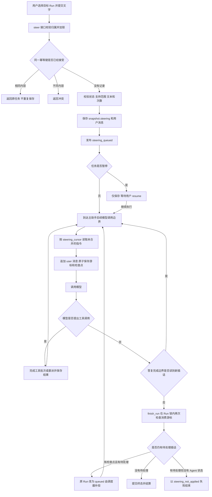

# YugiTalk HITL 实现流程与代码说明

更新时间：2026 年 11 月 13 日。

本文面向需要理解、维护或介绍 YugiTalk Agent 执行机制的开发者，说明人工介入的触发条件、状态保存、接口调用、执行恢复及失败边界。内容以当前工作区实现为准，包含本次新增的 Agent 插话功能。流程图使用 Mermaid，可在支持 Mermaid 的 Markdown 阅读器中直接渲染。

当前项目以 Run 作为任务身份，以数据库状态和检查点作为恢复依据。人工补充和插话均继续使用原任务的权限、预算及执行限制，不会因为一次人工交互重新获得执行额度。Agent 图使用 LangGraph；本文中的暂停、澄清恢复和插话由应用自身的 Run、检查点及调度器管理，没有通过 LangGraph 的 `interrupt()` 和原生 checkpointer 实现这条业务流程。

## 1 人工介入的三种方式

HITL 是 Human in the Loop，即人在执行过程中补充信息、调整方向或控制执行。项目中需要区分以下机制。

| 机制 | 发起方 | 典型场景 | 当前行为 |
| --- | --- | --- | --- |
| RAG 澄清 | 系统 | 问题漏掉对象或版本，不同理解会改变答案 | 保存 RAG 状态，进入 `waiting_input`，补充后重新检索 |
| Agent 插话 | 用户 | Agent 执行中，用户要求只看国内资料、改成表格 | 给原 Run 追加文字指令，在后续模型调用前加入上下文 |
| 执行控制 | 用户 | 临时暂停、继续，或停止整个任务 | 修改执行状态，由 Worker 在检查边界响应 |

管理员审核自定义工具发布属于另一条人工审核流程。历史 `Approval` 和 `waiting_approval` 结构仍然保留，但当前没有完整的逐次工具执行审批流程；恢复调度器会结束遗留的 `waiting_approval` 任务，释放其占用的预算。

### 总体流程图



这是一张机制总览图。实际的澄清、插话和执行控制分别通过对应接口进入，不存在一个统一的自然语言分类接口来选择这些分支。

## 2 Run 与检查点的数据分工

核心模型位于 [`backend/app/tasks/models.py`](../backend/app/tasks/models.py)。

| 字段或结构 | 保存的内容 | 对人工介入的作用 |
| --- | --- | --- |
| `Run.id` | 本次任务的唯一身份 | 澄清、插话和继续始终指向明确的任务 |
| `Run.status` | 排队、运行、暂停、等待输入或终态 | 判断当前允许哪些用户操作 |
| `Run.snapshot` | 执行配置、资源快照、来源及人工交互记录 | 保留原资源边界；保存澄清展示信息和插话记录 |
| `Run.checkpoint` | 恢复节点和完整业务状态 | Worker 重启后继续执行，无需依赖前端保留内存 |
| `Run.state_version` | 状态修订版本 | RAG 恢复拒绝旧页面提交的过期版本 |
| `lease_token` 与 `lease_until` | 当前 Worker 的执行所有权 | 阻止失去租约的旧 Worker 继续写入 |
| `reserved_tokens` 与 `charged_tokens` | 原任务预留和已计入的消耗 | 人工介入不重置原任务预算 |
| `RunEvent` | 可公开事件及递增序号 | 前端接收澄清、插话进度和执行状态，支持断线续传 |

RAG 检查点一般形如：

```python
run.checkpoint = {
    "node": "rag",
    "rag": {
        "phase": "clarify",
        "question": "这个版本怎么部署？",
        "queries": [...],
        "sources": [...],
        "rewrite_count": 0,
        "grade_count": 1,
        "clarification_count": 0,
        "grade": {...},
        "trace": [...],
    },
}
```

Agent 检查点保存消息、工具调用、工具游标、步数等；新增的 `steering_cursor` 表示已经合并了多少条插话。检查点由服务端管理，前端不能上传检查点来任意选择恢复位置。

## 3 RAG 如何判断需要人工澄清

显式选择知识库的任务会先执行 RAG，再进入回答阶段。入口位于 [`Execution._execute()`](../backend/app/tasks/execution.py)，RAG 编排位于 [`RagPipeline.execute()`](../backend/app/rag/pipeline.py)。

```text
plan → retrieve → rerank → grade
                         ↓
           answer / partial_answer / rewrite / clarify / no_knowledge
```

RAG 已经获得并整理证据后，评分器根据问题和证据包返回 `EvidenceGrade`，契约定义在 [`rag/contracts.py`](../backend/app/rag/contracts.py)。

```python
class EvidenceGrade(BaseModel):
    relevance: Literal["none", "weak", "strong"]
    answerability: Literal["none", "partial", "sufficient"]
    ambiguity: Literal["none", "missing_slot", "multiple_candidates"]
    route: Literal["answer", "partial_answer", "rewrite", "clarify", "no_knowledge"]
    hitl_prompt: str = Field(default="", max_length=240)
    hitl_options: list[str] = Field(default_factory=list, max_length=4)
```

`relevance` 判断证据是否相关，`answerability` 判断支持程度，`ambiguity` 判断用户是否缺少关键条件。`hitl_prompt` 和 `hitl_options` 是需要人工补充时的展示内容。选项最多 4 项，每项非空且不超过 120 字符。

判断原则写在 [`rag/prompts/grade.md`](../backend/app/rag/prompts/grade.md)：只有缺少会实质改变答案的对象、版本等关键条件，且无法从问题与证据确定时，才进入澄清。资料未覆盖、证据不完整或列举未穷尽，不等于用户问题有歧义。

例如，知识库有 v1、v2 两个版本，用户说“这个版本怎么部署”，可以询问版本；用户已明确说 v2，但知识库没有 v2 部署资料，应尝试有限改写、给出有依据的部分回答或说明没有相关知识。

### RAG 澄清流程图



模型的 `route` 只是建议。程序在 `pipeline.py` 再次约束：

```python
elif grade.ambiguity != "none":
    route = "clarify"
elif route == "clarify":
    route = (
        "answer"
        if grade.relevance == "strong"
        and grade.answerability == "sufficient"
        else "rewrite"
    )
```

也就是说，有明确歧义时优先澄清；模型建议澄清却没有标记歧义时，程序会将其校正为回答或改写。强相关、部分支持且无歧义的证据还会进入 `partial_answer`，保留来源并限定回答范围。

Pydantic 校验也会拒绝不一致字段。例如 `route="answer"` 必须同时满足强相关、充分支持、无歧义。结构化调用见 [`rag/model.py`](../backend/app/rag/model.py)。

`offline_grade()` 中检测“它的”“这个的”等词的规则用于 Mock 评分。有证据的非 Mock 路径使用评分模型，不能把这些关键词规则当成生产环境的全部歧义识别机制。当前空证据路径直接进入无相关知识，不依赖评分模型猜测。

## 4 RAG 暂停与恢复的具体实现

### 4.1 保存等待状态

`RagPipeline` 每完成一个阶段，通过 `save` 回调保存状态。显式知识库路径注入的是 [`Execution.save_rag()`](../backend/app/tasks/execution.py)。

当 `phase == "clarify"` 时，`save_rag()` 会执行以下操作，并在同一事务提交：

1. 保存 `checkpoint = {"node": "rag", "rag": state}`。
2. 保存来源和流程记录。
3. 写入 `snapshot.rag_clarification`，包含问题、选项与过期时间。
4. 追加 `clarification` 事件。
5. 将状态改为 `waiting_input`。
6. 调用 `stop_slice()`，累计已执行时间，清除时间片起点和租约。

随后 `Execution._execute()` 发现 RAG 返回 `clarify`，结束本次执行。等待人工补充的时间不会计入 `active_seconds`，也不要求 Worker 保留当前调用栈。

### 4.2 用户提交补充

接口定义在 [`rag/resume.py`](../backend/app/rag/resume.py)：

```http
POST /api/v1/runs/{run_id}/clarify
Idempotency-Key: <本次补充请求的唯一标识>
X-CSRF-Token: <当前会话的防伪令牌>
Content-Type: application/json
```

```json
{
  "answer": "我指的是 v2",
  "state_version": 8
}
```

补充文本最多 1000 字符。恢复前的主要校验如下。

| 校验 | 保护的边界 |
| --- | --- |
| `owned_run()` 与当前权限 | 当前用户必须拥有该任务并具有相应访问权限 |
| 用户和 Run 行锁 | 串行化状态读取、判断和更新 |
| 幂等键和请求体哈希 | 重复请求不重复写入消息；同键不同内容拒绝 |
| `waiting_input` 和 `state_version` | 必须恢复当前这一版等待状态 |
| Skill 和工具可用性 | 等待期间被停用的资源不能继续使用 |
| `expires_at` | 拒绝过期澄清 |
| 检查点阶段与计数 | 阻止非法阶段或绕过次数限制 |
| 文档归属、ready 状态、索引版本及集合 | 拒绝已删除、更新或不属于当前任务范围的旧来源 |
| 预算检查 | 预算保护启用时，消耗达到原预留额度不能继续 |

`state_version` 与幂等键解决不同问题：前者拒绝旧页面操作新状态，后者处理“服务器已接受，但客户端未收到响应”的重试。幂等回执先于等待状态校验，因此已被接受的相同请求，即使任务已经重新排队，也可以正常重试。

### 4.3 从检索阶段恢复

恢复时不创建新 Run，而是改写原检查点：

```python
question = str(state["question"])[:1000] + "\n补充：" + data.answer.strip()

run.checkpoint = {
    "node": "rag",
    "rag": {
        **state,
        "question": question,
        "queries": [question],
        "phase": "retrieve",
        "sources": [],
        "clarification_count": 1,
    },
}
```

原问题在组合时最多保留前 1000 字符；补充后直接从 `retrieve` 开始，不重新进入 `plan` 拆题。原有改写和评分计数继续保留。

清空旧证据的原因是补充条件可能改变候选文档。用户指定 v2 后，需要让新条件影响召回、重排和证据评判；只把 v2 加进最终回答 Prompt，仍可能让回答依赖主要来自 v1 的旧证据。

接口还会清空快照来源，保存幂等回执和用户补充消息，将原任务改为 `queued`，提交事务后再投递。如果即时投递失败，数据库中的排队意图仍然存在，由现有调度器补投。

当前限制是一次人工澄清、一次查询改写、两次证据评判。澄清默认等待 1800 秒，可通过 `RAG_HITL_TTL_SECONDS` 配置为 60 至 7200 秒。等待过期后由调度器以 `rag_clarification_expired` 结束并结算。次数与预算跨恢复保留，不会每轮人工交互重新发放。

## 5 Agent 插话的提交与持久化

插话适合用户主动改变尚在执行的任务。例如：“只看国内资料，最后用表格回答”。实现入口是 [`tasks/router.py` 中的 `steer_run()`](../backend/app/tasks/router.py)。

```http
POST /api/v1/runs/{run_id}/steer
Idempotency-Key: <本次插话请求的唯一标识>
X-CSRF-Token: <当前会话的防伪令牌>
Content-Type: application/json
```

```json
{
  "message": "只看国内资料，最后用表格回答"
}
```

接口返回 202 和原 Run 的公开状态。允许 `queued`、`running`、`paused`，不允许终态任务或 `waiting_input`。暂停期间提交不会自动恢复执行；等待 RAG 澄清时应使用 `/clarify`。

输入契约为 [`SteeringInput`](../backend/app/tasks/contracts.py)，单条最多 6000 字符且不能全为空白，每个 Run 最多接受 20 条。深度研究使用独立执行器，目前返回 `steering_unsupported`；任务响应提供 `steering_supported`，前端据此筛选可插话目标。

提交操作按空间用户、当前用户、会话、Run 的顺序加锁，再完成幂等检查、状态检查和写入。该锁序与相关任务创建、结算逻辑协调，避免把状态判断与真正写入分成两个不受保护的步骤。

插话存储在原 Run 的 JSON 快照中，无需新增数据库表：

```python
run.snapshot = {
    **run.snapshot,
    "steering": [
        {
            "key": "本次请求的幂等键",
            "hash": "原始 message 的 SHA256",
            "message": "只看国内资料，最后用表格回答",
        }
    ],
}
```

同一事务还会写入一条用户聊天消息、递增状态版本、追加 `steering_queued` 进度事件并记录审计。相同幂等键和相同内容重试直接返回原任务；同键不同内容返回 409，避免重复指令与重复聊天消息。

插话是追加动作，不要求客户端提交 `state_version`。后端依靠任务归属、行锁、当前状态检查和幂等键保护追加过程。RAG 澄清则针对一个特定等待状态恢复，因此需要客户端携带状态版本。两种接口使用不同的并发约束，是由操作语义决定的。

### Agent 插话流程图



图中省略了各模型调用处的权限、租约、预算、上下文及步数检查；这些检查始终生效。接受插话不代表任务必然还能完成下一轮调用。

## 6 插话如何进入模型上下文

核心消费方法是 [`Execution.steer()`](../backend/app/tasks/execution.py)。每条指令不是发送到一个独立 Agent，而是加入原任务主助手的后续消息列表。

```python
instructions = run.snapshot.get("steering", [])
cursor = state.get("steering_cursor", 0)

# 仅追加尚未合并的指令，保持提交顺序。
state["messages"] = [
    *state["messages"],
    *[
        {
            "role": "user",
            "content": "用户对当前任务的补充指令：\n" + item["message"],
        }
        for item in instructions[cursor:]
    ],
]
state["steering_cursor"] = len(instructions)
```

上述为核心逻辑摘录。完整方法还会检查任务、租约和当前权限，将消息、消费游标、序列化工具调用和恢复节点一起保存，并在同一事务追加 `steering_applied` 事件。

使用 `user` 角色可以表达用户对任务的新要求，同时保留系统策略和工具权限边界。插话不会提升为系统指令，也不会增加助手可调用的工具 Schema。

`steering_cursor` 保存的是已经合并到 Agent 状态中的指令条数。例如，快照共有三条指令、游标为 1，下一次只追加后两条。游标和消息一起持久化，避免 Worker 重启后只知道“已消费”，却找不到对应消息，或每次恢复都重复追加。

这保证了检查点层面的重复注入控制，不表示模型请求具备严格的 exactly once 语义。未提交的模型调用在恢复后仍可能再次执行和计费。

### 不同提交时机的行为

| 提交时机 | 实际生效位置 |
| --- | --- |
| 排队期间 | 第一次主助手模型调用前 |
| 模型请求进行中 | 当前请求结束后，在后续边界处理 |
| 工具批次执行中 | 该批次完成并保存结果后，进入下一轮主助手模型调用 |
| 子助手委派执行中 | 当前委派完成后，由父助手在后续模型调用读取 |
| 暂停期间 | 先保存，用户继续后在执行边界处理 |
| 原回答即将结束 | 检查新指令，必要时增加一轮或将原 Run 重新排队 |

接入点包括普通 `Execution` 图、`run_direct()` 和 `run_router()`。后两者位于 [`agents/subagents.py`](../backend/app/agents/subagents.py)。子助手不会分别消费父 Run 的插话，避免同一条指令被多个分支重复处理；父助手收到新要求后，决定后续是否再次委派以及委派内容。

## 7 如何避免任务结束前丢失插话

只在模型调用前读取指令会漏掉一种情况：模型开始生成最后一轮回答后，用户才提交插话；模型生成结束，没有新的工具调用，任务随即结束。

当前实现设置了两层检查。

### 7.1 模型完成边界检查

在 [`agents/graph.py`](../backend/app/agents/graph.py) 中，模型没有提出工具调用时，再次读取插话：

```python
if not reply.calls and steer:
    result["steering_pending"] = steer(result)
```

如果确实合并了新指令，`steering_pending` 为真，保存的下一节点为 `model`，图继续模型调用，不直接进入结束。下一轮调用前会清除这个控制标记，避免无新指令时一直循环。

### 7.2 最终结算时再检查

模型完成边界检查与最终结算之间仍存在短暂窗口，因此 [`finish_run()`](../backend/app/tasks/execution.py) 在持有 Run 行锁时比较：

```python
state.get("steering_cursor", 0) < len(run.snapshot["steering"])
```

如果仍有待处理指令且存在 Agent 状态，就将检查点下一节点设为 `model`，结束当前时间片和租约，保持原任务改为 `queued`，暂不提交成功终态，也不释放整笔预留预算。随后由现有调度器补投。

| 竞争顺序 | 结果 |
| --- | --- |
| 插话先提交，结算随后拿到锁 | 发现未处理指令，原 Run 重新排队 |
| 结算先提交成功终态，新插话随后拿到锁 | 新插话被拒绝，不向用户假报已接受 |
| 已接受的相同请求在任务结束后重试 | 幂等回执先命中，返回原任务，不重复保存 |

如果存在待处理指令却没有可继续的 Agent 状态，例如显式知识库路径在进入 Agent 前就因没有证据结束，结算会以 `steering_not_applied` 失败，避免静默报告插话已处理。

额外模型调用仍受原 `max_steps`、Token 预算、上下文容量及超时限制。已接受指令但剩余步骤不足时，任务可以以 `model_step_limit` 等错误结束，不能靠插话重置上限。

## 8 闭环执行与暂停继续

闭环执行逻辑位于 [`agents/loop.py`](../backend/app/agents/loop.py)，主要阶段为规划、执行、检查与必要的修订。插话回调在阶段边界接入，并传递到执行图。如果在准备检查旧候选答复时合并了新指令，流程会转到修订阶段，避免直接沿用旧完成标准确认成功。

规划、执行和检查继续累计模型步数，原有预算与时间限制不会因人工介入清零。

普通暂停通过以下接口完成：

```text
POST /api/v1/runs/{run_id}/pause
POST /api/v1/runs/{run_id}/resume
POST /api/v1/runs/{run_id}/cancel
```

实现位于 [`tasks/router.py`](../backend/app/tasks/router.py)，执行侧在 `Execution.check()` 响应暂停。

| 项目 | RAG 等待补充 | 普通暂停 |
| --- | --- | --- |
| 状态 | `waiting_input` | `paused` |
| 进入原因 | 系统需要关键条件 | 用户要求临时停止推进 |
| 当前租约 | 结束时间片并清除租约 | 原 Worker 可继续持有并续租 |
| 当前调用栈 | 本次 Worker 执行结束 | 原 Worker 有效时优先保留 |
| 恢复入口 | `/clarify`，携带补充和版本 | `/resume`，不携带新指令 |
| 恢复位置 | 清空证据，从 `retrieve` 开始 | 原执行栈，或失联后的最近检查点 |
| 等待时间 | 不计入实际执行时间，有澄清期限 | 不计入实际执行时间，外部请求和 Worker 原有超时仍有效 |

暂停等待期间会释放数据库事务和行锁，让继续、取消及续租操作能够获得连接。正在执行的有绝对截止时间的网络工具和检索批次会先完成并保存结果，再在边界等待；服务端不能冻结供应商已经开始的远端计算。

`resume` 优先把有效原租约的任务恢复为 `running`，唤醒原栈；没有有效租约时，保留检查点重新排队。`cancel` 则进入取消流程，保留已公开正文并按统一逻辑结算。

## 9 前端如何选择操作

前端主要实现位于 [`ChatView.tsx`](../frontend/src/chat/ChatView.tsx)、[`ChatTask.tsx`](../frontend/src/chat/ChatTask.tsx) 和 [`ProcessSummary.tsx`](../frontend/src/chat/ProcessSummary.tsx)。

存在可插话任务时，输入框默认选择最近任务；“消息目标”可以指定另一个活动任务，也可以选择“发送新任务”。这样，用户输入一句补充要求时，能够明确它修改的是哪个 Run。

前端会保留插话文本、目标 Run 和幂等键。相同文本失败重试时复用原键和目标，即使最近任务发生变化，也不会把重试误发给另一个任务。用户明确切换目标后才清除该请求标识。

| 用户操作 | 请求路径 |
| --- | --- |
| 对等待澄清的任务补充条件 | `/runs/{id}/clarify` |
| 对活动任务追加文字要求 | `/runs/{id}/steer` |
| 选择发送新任务 | `/runs` |
| 暂停、继续、停止 | `/runs/{id}/pause`、`resume`、`cancel` |

插话进度分成两个事件：

- `steering_queued`：后端已接受并持久化。
- `steering_applied`：指令已加入当前任务的 Agent 消息和检查点。

“已加入上下文”不表示模型已经成功执行要求。模型后续可能因预算、步骤、网络或证据限制失败，前端仍应显示最终任务结果。已公开的正文保留，后续普通回答追加；闭环任务的候选答复仍按原机制隐藏，最终结算后发布。

## 10 为什么选择这套实现

以下是根据当前结构分析出的工程取舍，不代表存在独立的原始设计决策记录。

| 选择 | 解决的问题 | 相应代价或限制 |
| --- | --- | --- |
| 数据库保存 Run 和检查点 | 用户稍后回来、Worker 重启或重新投递时仍可继续 | 应用需要自行维护状态转换和恢复校验 |
| 澄清与插话使用原 Run | 保留任务身份、审计、配置、已用额度和次数 | 新要求也受原剩余预算与步骤限制 |
| 模型判断歧义，程序校正路由 | 处理自然语言语义，同时约束字段和执行边界 | 无法证明模型对歧义的判断总是正确 |
| 澄清后重新检索 | 让对象或版本等补充条件真正影响候选证据 | 增加检索和评判开销，不重新运行完整拆题 |
| 插话在模型边界合并 | 不破坏当前请求和工具回包的完整性 | 用户指令不会立即中断当前批次或撤销已有操作 |
| 指令与消费游标一起保存 | 恢复后不重复注入，指令已接收状态可追踪 | 不提供模型请求和外部副作用的全链路 exactly once 保证 |
| 结束边界与结算锁双重检查 | 覆盖最后一轮回答期间及结算前的插话竞争窗口 | 极晚到达的指令可能需要原任务重新排队 |

## 11 当前支持范围与明确限制

1. 插话只支持文字，附件通过新任务发送。
2. 插话不扩充原工具权限，也不修改助手版本、配置和预算上限。
3. 正在执行的模型请求、工具批次及委派会先完成；插话不能撤销已产生的外部操作。
4. 深度研究使用独立执行器，目前不支持这条插话链路。
5. 插话本身不强制清空已检索证据，也不强制重跑显式知识库 RAG。自动知识检索路径由主助手后续决定是否再次调用检索工具；RAG 歧义补充仍应使用 `/clarify`。
6. Agent 内部 `knowledge_search` 遇到歧义时返回 `needs_clarification`、评分及空来源，由主助手处理，不会直接把父 Run 改为 `waiting_input`。该返回值不等于已经建立可由 `/clarify` 恢复的等待任务。
7. 历史逐次工具审批结构不等于当前可用的工具执行审批功能。
8. 幂等提交及检查点游标保护不同于业务副作用的严格单次执行保证。中断恢复仍需遵守原有工具账本、授权和结果不确定性处理。

### 两个使用示例

**RAG 澄清。** 用户问“这个版本支持什么部署方式”，评分发现版本不明，任务进入 `waiting_input`。用户补充“v2”，接口校验当前版本及旧来源，清空旧证据，恢复同一 Run，从检索开始。补充后仍缺乏有效证据时说明没有相关知识，不用模型常识补出知识库答案。

**执行中插话。** 用户让 Agent 调研多个方案，工具批次进行中要求“只保留国内方案，用表格回答”。接口先保存指令和用户消息；当前批次完成后，父助手把新要求放入后续模型上下文。模型可以根据新要求继续检索或整理结果，但已经完成的查询不会自动撤销，原步骤不足时任务仍可能失败。

## 12 错误与处置

| 场景 | 典型响应或错误 | 处理方式 |
| --- | --- | --- |
| 澄清使用旧状态版本 | 409 `rag_resume_conflict` | 刷新任务，针对当前等待状态操作 |
| 澄清已经过期 | 410 `rag_clarification_expired` | 不恢复旧等待，重新发起明确问题 |
| 澄清来源已删除或更新 | 409 `knowledge_source_removed` | 重新建立有效证据范围后发起任务 |
| Skill 或工具被停用 | 恢复校验错误 | 不沿用已撤销资源，修正配置后再操作 |
| 对终态或等待澄清任务插话 | 409 `steering_unavailable` | 终态任务另开任务；等待澄清使用 clarify |
| 同一插话幂等键换内容 | 409 `steering_conflict` | 新操作使用新幂等键，不覆盖旧请求 |
| 单个 Run 已接受 20 条插话 | 429 `steering_limit` | 新建任务并明确完整要求 |
| 深度研究任务插话 | 409 `steering_unsupported` | 当前路径不支持，不能把接受请求当作已生效 |
| 待处理插话没有可恢复 Agent 状态 | `steering_not_applied` | 原任务失败，重新发送明确任务 |
| 插话后的下一轮超出限制 | `model_step_limit`、`token_budget_exhausted` 或其他原有错误 | 保留明确失败结果，不重置原限制 |
| 非本人任务或缺少 CSRF | 404 或 403 | 使用正确账号及有效会话，不跨用户操作 |

## 13 代码阅读顺序

建议先阅读模型和状态，再沿入口、执行边界和恢复接口追踪，而不是只搜索 `HITL` 关键字。

| 顺序 | 文件与函数 | 重点 |
| --- | --- | --- |
| 1 | [`tasks/models.py`](../backend/app/tasks/models.py) 中 `Run`、`RunEvent` | 状态、快照、检查点、租约及预算 |
| 2 | [`rag/contracts.py`](../backend/app/rag/contracts.py) 中 `EvidenceGrade`、`ClarificationInput` | 评分与补充的输入边界 |
| 3 | [`rag/pipeline.py`](../backend/app/rag/pipeline.py) 中 `RagPipeline.execute` | 评分路由、程序校正与次数限制 |
| 4 | [`tasks/execution.py`](../backend/app/tasks/execution.py) 中 `save_rag`、`_execute` | 保存 waiting_input、退出与重新执行 |
| 5 | [`rag/resume.py`](../backend/app/rag/resume.py) 中 `clarify` | 幂等、状态版本、资源校验及重新检索 |
| 6 | [`tasks/router.py`](../backend/app/tasks/router.py) 中 `steer_run` | 插话事务、幂等记录和用户消息 |
| 7 | [`tasks/execution.py`](../backend/app/tasks/execution.py) 中 `steer` | 合并指令、保存消费游标和检查点 |
| 8 | [`agents/graph.py`](../backend/app/agents/graph.py) 中 `model` 与条件边 | 模型调用前和答复结束后的插话处理 |
| 9 | [`tasks/execution.py`](../backend/app/tasks/execution.py) 中 `finish_run` | 最终结算竞争窗口及原任务重新排队 |
| 10 | [`agents/loop.py`](../backend/app/agents/loop.py)、[`agents/subagents.py`](../backend/app/agents/subagents.py) | 闭环、直接执行、Router 与子助手边界 |
| 11 | [`tasks/router.py`](../backend/app/tasks/router.py)、[`tasks/reliability.py`](../backend/app/tasks/reliability.py) | 暂停继续、租约、排队补投及澄清过期 |
| 12 | [`ChatView.tsx`](../frontend/src/chat/ChatView.tsx)、[`ChatTask.tsx`](../frontend/src/chat/ChatTask.tsx) | 目标选择、幂等重试、澄清卡片及控制按钮 |

## 14 验证结果和证据边界

本次实现后已完成以下验证，数值对应本次开发和部署阶段的实际结果，不是持续监控承诺。

| 验证 | 结果 | 覆盖范围 |
| --- | --- | --- |
| 后端相关回归 | 162 项通过 | 插话、暂停恢复、Agent 图、直接执行、委派、RAG、闭环及基础任务 |
| 前端单元测试 | 95 项通过 | 前端源代码测试集，包含插话事件文案 |
| Edge 浏览器测试 | 2 项通过 | 暂停时插话、失败重试复用幂等键、多任务目标选择、新任务路径和 360 像素布局 |
| 静态与构建检查 | 通过 | Ruff、Mypy、ESLint、TypeScript 和 Vite 构建 |
| 本机部署验收 | 通过 | 11 个服务健康、首页与 API 就绪返回 200、插话页面资源和后端入口存在、3 个关键源码文件散列一致、CUDA 可用 |

新增行为测试见 [`backend/tests/test_steering.py`](../backend/tests/test_steering.py)，包括幂等与归属、不可用状态、首轮前插话、最后一轮生成期间插话、工具执行中插话、暂停后继续、结算竞态、恢复不重复注入、步骤上限、结束后幂等重试、指令顺序与次数、CSRF、Router 和闭环候选更新。

浏览器测试见 [`frontend/tests/steering/steering.spec.ts`](../frontend/tests/steering/steering.spec.ts)。可在 `frontend` 目录运行：

```powershell
npm exec playwright -- test --config=playwright.steering.config.ts
```

本次后端回归使用隔离 SQLite 和脚本化模型；浏览器测试使用隔离页面和模拟 API。它们验证了流程与交互，不证明真实模型一定正确理解并完成用户的每条指令，也未覆盖生产 PostgreSQL 行锁和 Celery 队列的全链路并发竞态。

部署记录位于本项目 `.cache/hitl-deployment-20261113.json`。该记录核对了实际运行服务与源码，但没有发起真实模型业务请求，不能把健康检查通过表述成真实模型插话效果已验收。实际公网入口连通性也不在该本机验收范围内。
