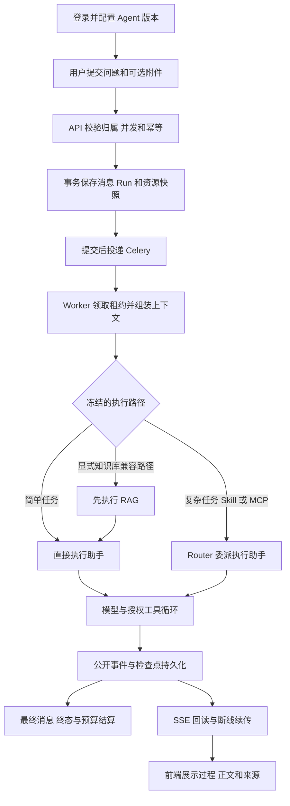

# YugiTalk 项目调用流程

更新日期：2026 年 11 月 13 日。本文按当前源码解释从启动、上传资料到问答、工具执行、人工介入及恢复的调用顺序。示例用于说明机制，不是新的业务运行结果；测试和上线状态分别查看具体报告。

## 两条主流程

资料入库在后台提前准备证据；在线任务按授权范围检索并回答。当前资源直接归用户，默认聊天不需要手动选择知识库。

## 1 启动与登录

开发入口是 `start.ps1` 或明确的 Compose 命令，热更新使用 `backend/start.py` 和 Vite。数据库 migrate 成功后 API、Worker 才启动；本地嵌入依赖已有模型缓存。详见 [DEVELOPMENT](DEVELOPMENT.md)。

`identity/dependencies.py` 校验会话、当前用户有效性、受信 Origin 和写请求的 CSRF。`accounts/access.py` 从会话推导资源归属，不接受客户端借 account_id 访问其他用户。平台管理员接口独立校验权限。

## 2 文档入库

1. `rag/router.py` 接收知识库原始文件流，校验归属、后缀、大小和重复文件。
2. 原文写入对象存储，SQL 保存文档状态与索引版本；提交后投递索引任务。
3. `rag/indexing.py` 领取文档租约，`parser.py`、Docling 和分块模块解析成父子块。PDF、Office、JSONL 的资源和处理方式不同。
4. `embeddings.py` 请求独立嵌入服务；SQL 保存原文关系，Milvus 保存检索索引。
5. 所有必要步骤成功后发布当前版本为 ready；失败保留诊断状态，不能把半成品作为证据。
6. 删除先将文档设为不可检索，随后清理对象、索引和图谱；来源点击还会重新验证。

分块算法、NUL 清理、独立索引时限和重试范围见 [DOCUMENT_CHUNKING](DOCUMENT_CHUNKING.md)，图谱见 [KNOWLEDGE_GRAPH](KNOWLEDGE_GRAPH.md)。

## 3 创建 Run

入口为 `POST /api/v1/runs`，契约在 `tasks/contracts.py`。请求携带 `conversation_id`、`agent_version_id`、`message`，可选 Skill、附件、研究项目或兼容知识库字段。

`tasks/router.py` 校验会话和资源，按固定顺序加锁。请求哈希配合 `Idempotency-Key` 防止重复建任务或同键换内容；预算保护启用时检查额度，并执行独立的并发限制。

用户消息、Run、预留记录及配置快照在同一事务保存。快照冻结助手版本、模型连接、工具目录、Skill、RAG 配置及会话截止序号。先提交再投递；投递失败由 Scheduler 从 queued 记录补投。同一会话允许多个任务，但仍受用户及账号并发限制。

## 4 Worker 与会话上下文

`tasks/execution.py` 的 `Execution.execute()` 只领取 queued Run，生成新的租约令牌并增加 attempts。`LeaseKeeper` 在慢请求期间续租，旧 Worker 失去令牌后不得再提交。

`memory/context.py` 只读取创建 Run 时截止序号以内的历史及适用摘要，旧任务不会自动读取后来新增的普通消息。长期记忆按用户偏好和当前检索规则加入；候选排序见 [MEMORY_RANKING](MEMORY_RANKING.md)。

已有图检查点时直接沿用其中的消息和工具结果，不丢弃工具上下文重新拼历史。附件内容是用户级资料；`0026_message_uploads` 让附件提取文本跟随消息保留。

## 5 路由与子助手

`router_mode` 和 `direct_mode` 在创建任务时冻结，恢复时不重新路由。

- `run_direct()` 直接运行执行助手，省去委派和汇总。短单意图问题还必须满足无 Skill、无 MCP 等条件；新会话简单闭环问答可走这条快速路径。
- `run_router()` 向主模型提供委派工具，执行助手继承所选版本的模型、提示词和权限，自行调用业务工具。
- 父图和子执行状态分别保存在检查点中，共用原 Run 的取消、租约、时间与预算。
- 显式知识库兼容路径先跑 RAG，再把证据加入 Agent。自动知识检索在工具内执行，不必先由前端选择库。

具体代码是 `agents/routing.py`、`agents/subagents.py` 和 `tasks/router.py`。闭环控制及简单路径例外见 [AGENT_CLOSED_LOOP](AGENT_CLOSED_LOOP.md)。

## 6 检索与证据

`RagPipeline` 依次规划、召回、重排、评判和合成证据。Dense 与 BM25 经 RRF 融合，可选图谱和重排；外部命中还要经过 SQL 当前权限、文档状态、版本和原文 materialize 校验。

`pack_evidence()` 将证据装入上下文预算，评分与回答使用对应证据包。评分模型提出路由，程序再约束 `answer`、`partial_answer`、`rewrite`、`clarify` 和 `no_knowledge`。

强相关但仅部分支持且无歧义时保留来源，回答模型限定覆盖范围。问题缺关键条件才澄清；证据不足不能全部转成用户确认。一次改写、两次评分和一次人工澄清跨恢复保留。

自动知识工具把真实证据与 coverage 交给主助手；`needs_clarification` 只是工具结果，不直接挂起父 Run。显式知识库路径的 clarify 会进入 waiting_input。详见 [ENHANCED_RAG](ENHANCED_RAG.md) 和 [HITL](HITL.md)。

## 7 模型和工具循环

`agents/graph.py` 每次调用模型前复核任务并保存检查点，传递冻结的工具 Schema。模型返回工具提案后，服务端复核许可、参数和执行边界，工具结果通过调用 ID 回填消息。

内置工具、HTTPS、MCP、研究文件及种子下载有不同的执行和恢复约束，不能统一描述成纯只读操作。工具目录见 [TOOL_MANAGEMENT](TOOL_MANAGEMENT.md)、[MCP](MCP.md)、[DEEP_RESEARCH](DEEP_RESEARCH.md) 和 [TORRENT_TOOL](TORRENT_TOOL.md)。

成功工具结果和调用键进入账本；图保存工具游标，恢复时跳过已经提交的执行。历史 `max_tool_calls` 保留兼容，当前不按该字段强制次数额度；模型步数、超时、上下文、重复调用和授权检查仍生效。普通执行最后一轮保留给有界回答。

`answer_policy.py` 合并有效证据并限制回答，引用校验在正文生成结束后进行。已经流式公开但最终未通过校验的部分正文不能被当成已验证答案。

## 8 人工介入

| 操作 | 恢复方式 |
| --- | --- |
| `/clarify` | 对 waiting_input 补充条件，校验状态版本并清空旧证据，从 retrieve 继续 |
| `/steer` | 向原 Run 追加 user 级指令，主助手在后续模型边界按消费游标合并 |
| `/pause`、`/resume` | 优先保留原栈和租约；无有效执行者时从检查点排队 |
| `/cancel` | 停止后续推进，保留已公开内容并结算 |

插话不立即撤销当前模型请求、工具批次或委派；最终结算会在 Run 锁内再次检查未处理插话，必要时将原任务重新排队。详细流程图、幂等和失败边界统一见 [HITL](HITL.md)。

## 9 流式输出和结束

`TextStream` 按字符数和片段到达时的时间阈值合并正文，异常时交付尾部。`RunEvent` 递增序号保存公开内容；SSE 通过 Redis 通知唤醒并回读 SQL，丢通知仍能定期补读。

前端 `tasks/api.ts` 保存游标，断线通过 `Last-Event-ID` 续传，按序号去重。关闭网页不取消后台任务。事件过滤仍推进游标，终态和恢复等控制事件不能被过滤。详见 [OBSERVABILITY](OBSERVABILITY.md) 和 [CONCURRENCY](CONCURRENCY.md)。

`finish_run()` 在权限、租约和行锁保护下提交最终消息、状态、结束事件和预算结算，重复完成不重复结算。闭环候选只在最终交付时公开；普通模式保留已公开部分正文。

## 10 故障恢复与验证口径

Scheduler 回收过期 Run 租约，保留已提交检查点后重新排队；文档索引中断则增加索引版本并从原文重建。来源撤销、用户停用、工具变化、预算和次数限制均不能通过恢复绕过。

未完成的模型请求可能重新执行和计费，外部操作结果未知时不能盲目重放。业务状态、工具结果和索引版本控制不构成跨所有外部系统的分布式事务。

当前实现入口见 [MODULE_GUIDE](MODULE_GUIDE.md)，接口见 [API](API.md)，使用与故障演练见 [RUNBOOK](RUNBOOK.md)。评测必须区分检索指标、答案质量、受控拒绝和不同负载条件，详见 [评测目录](evaluation/README.md)。
