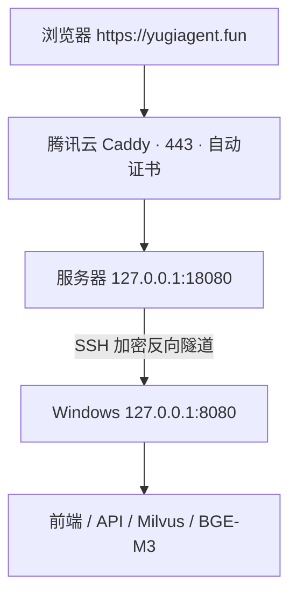

# 腾讯云 HTTPS 网关与本机加密隧道

适用：腾讯云 Ubuntu 轻量服务器作为入口，Windows 本机运行现有 YugiTalk。下面使用已解析的 `yugiagent.fun` 和截图公网 IP `1.117.231.2`；先核对腾讯云实例公网 IP 是否一致。不是把 Milvus、BGE-M3 搬到 2GB 服务器。配置已准备，尚未连接服务器、申请真实证书或完成外部访问验收。



## 1. 腾讯云控制台

实例详情 → 防火墙：允许 TCP 80、443，来源 `0.0.0.0/0`；SSH 实际端口（通常 22）只允许本机出口公网 IP。不要开放 18080、数据库、Milvus 或模型端口。系统防火墙若启用也需允许这三个入口。更新 SSH 防火墙前保留当前控制台登录会话。

DNS 的 `@` A 记录应指向 `1.117.231.2`。本指南只用根域名；`agent` 和 `api` 暂不配置独立入口。

## 2. Windows 创建专用 SSH 密钥

项目根目录 PowerShell 执行：

```powershell
New-Item -ItemType Directory -Force ./data/gateway | Out-Null
ssh-keygen -t ed25519 -f ./data/gateway/tunnel_ed25519 -C yugitalk-tunnel
Get-Content ./data/gateway/tunnel_ed25519.pub
```

若文件已经存在，不要覆盖。私钥留在本机项目目录，不上传、不提交。推荐设置口令并加载 Windows ssh-agent；后续 `BatchMode=yes` 需要密钥已经可用。`data/gateway` 仅允许你本人和系统读取。复制输出的公钥整行到下一步，公钥可复制，私钥不可复制。

## 3. 腾讯云终端安装入口

在腾讯云控制台点击实例“登录”，以下命令在 **Ubuntu 服务器** 执行。先确认 80/443 没有被宝塔、Nginx 或其他服务占用：

```bash
sudo ss -lntp
sudo apt-get update
sudo apt-get install -y caddy
sudo adduser --disabled-password --gecos '' yugitalk-tunnel
sudo install -d -m 700 -o yugitalk-tunnel -g yugitalk-tunnel /home/yugitalk-tunnel/.ssh
sudo nano /home/yugitalk-tunnel/.ssh/authorized_keys
```

在 `authorized_keys` 粘贴上一节生成的公钥整行，保存。然后：

```bash
sudo chown yugitalk-tunnel:yugitalk-tunnel /home/yugitalk-tunnel/.ssh/authorized_keys
sudo chmod 600 /home/yugitalk-tunnel/.ssh/authorized_keys
sudo nano /etc/ssh/sshd_config.d/60-yugitalk-tunnel.conf
```

粘贴项目 `deploy/tencent/sshd-tunnel.conf` 全部内容，保存；验证并重新加载，不关闭当前登录窗口：

```bash
sudo sshd -t
sudo systemctl reload ssh
sudo sshd -T -C user=yugitalk-tunnel,host=localhost,addr=127.0.0.1 | grep -E 'allowtcpforwarding|permitlisten|gatewayports|maxsessions|authenticationmethods'
```

应分别包含 `remote`、`127.0.0.1:18080`、`no`、`0`、`publickey`。若不一致，检查已有 SSH 配置，不继续建立隧道。

编辑 Caddy 配置：

```bash
sudo nano /etc/caddy/Caddyfile
```

用项目 `deploy/tencent/Caddyfile` 内容替换默认示例，保存后执行：

```bash
sudo caddy validate --config /etc/caddy/Caddyfile
sudo systemctl enable --now caddy
sudo systemctl reload caddy
sudo journalctl -u caddy -n 60 --no-pager
```

Caddy 自动申请并续期受信任证书，无需手工下载证书。DNS、80/443 可达且无冲突是前提；Ubuntu 软件源安装失败时按官方安装文档操作。隧道尚未建立时出现 502 是预期现象，不表示证书失败。

## 4. Windows 本机准备项目

先在根目录私有 `.env` 将 `SESSION_SECRET` 改为独立随机值（至少32位），不要发到聊天。修改会使原有登录会话失效。先将曾在截图暴露的 SMTP 授权码更新，并修改已公开的管理员密码。上线入口前确认其他用户账户和权限符合预期。

PowerShell 在 `E:\Code\YugiTalk` 执行：

```powershell
docker compose -f docker-compose.yml -f docker-compose.gateway.yml config --quiet
docker compose -f docker-compose.yml -f docker-compose.gateway.yml up -d api worker scheduler frontend
docker compose -f docker-compose.yml -f docker-compose.gateway.yml ps
curl.exe -f http://127.0.0.1:8080/health/ready
```

本机 BGE-M3 容器若未运行，按开发启动说明开启 `local-embedding`。保持已有模型缓存位置，不迁移或重新下载。此覆盖文件允许正式域名及明确列出的本机入口，可使用 `https://yugiagent.fun` 或 `http://127.0.0.1:8080` 登录。代理按照入口协议设置会话 Cookie：HTTPS 添加 Secure，本机 HTTP 不添加；HttpOnly、SameSite=Lax 与可信来源校验继续保留。

## 5. Windows 建立加密隧道

新开一个 PowerShell 窗口，在项目根目录执行：

```powershell
ssh -N -T -p 22 -i ./data/gateway/tunnel_ed25519 -o ExitOnForwardFailure=yes -o ServerAliveInterval=30 -o ServerAliveCountMax=3 -R 127.0.0.1:18080:127.0.0.1:8080 yugitalk-tunnel@1.117.231.2
```

SSH 端口不是22时替换 `-p 22`。首次连接必须把主机密钥指纹与腾讯云终端的 `sudo ssh-keygen -lf /etc/ssh/ssh_host_ed25519_key.pub` 结果核对，匹配后输入 yes；不要关闭主机密钥验证。命令没有输出、持续占用窗口通常表示隧道运行中，Ctrl+C 可断开。

验证成功后，如需要断线自动重连，可在同一个窗口执行：

```powershell
while ($true) {
    ssh -N -T -p 22 -i ./data/gateway/tunnel_ed25519 -o BatchMode=yes -o StrictHostKeyChecking=yes -o ExitOnForwardFailure=yes -o ServerAliveInterval=30 -o ServerAliveCountMax=3 -R 127.0.0.1:18080:127.0.0.1:8080 yugitalk-tunnel@1.117.231.2
    Start-Sleep -Seconds 10
}
```

需要本机一直在线、Docker 一直运行，电脑休眠、关闭窗口或断网会使访问中断。此循环是手动运行方式，尚未配置开机计划任务。

## 6. 逐层验收

腾讯云终端执行：

```bash
ss -lnt | grep 18080
curl -f http://127.0.0.1:18080/health/ready
curl -f https://yugiagent.fun/health/ready
```

18080 必须只显示 `127.0.0.1:18080`，不能是 `0.0.0.0:18080`。两个健康请求都应成功。随后手机关闭 Wi-Fi，用移动网络打开 `https://yugiagent.fun`：验证页面、登录、验证码、对话流式输出、停止、上传与检索、管理员权限。真实模型和验证码测试会调用已配置外部服务，应由你手动执行。

| 现象 | 检查 |
| --- | --- |
| HTTPS 证书错误 | DNS、公网80/443、防火墙、Caddy日志；不要使用忽略证书验证作为验收 |
| 502 | SSH 窗口、本机 Docker、服务器18080监听、本机健康检查 |
| 登录或创建对话403 | 确认地址在 `docker-compose.gateway.yml` 的可信来源列表中，并已重新创建 API 容器；本机可使用 http://127.0.0.1:8080 |
| 登录后又退出 | 浏览器会话Cookie、SESSION_SECRET一致性、是否HTTP访问 |
| 回复不流式显示 | 确认两端代理均关闭缓冲，隧道未频繁断线 |

## 7. 停止与回到本机开发

先 Ctrl+C 停止隧道，再按原始配置重建受影响服务：

```powershell
docker compose up -d --force-recreate api worker scheduler frontend
```

不删除本机数据。云端停止入口可用 `sudo systemctl stop caddy`。这份方案是本机开发栈的受控公网演示，未完成完整生产加固、真实服务器验收、远端备份或恢复验证；不能据此把阶段6标记为生产验收通过。

参考：[Caddy HTTPS](https://caddyserver.com/docs/automatic-https)、[Caddy反向代理](https://caddyserver.com/docs/caddyfile/directives/reverse_proxy)、[SSH转发限制](https://man.openbsd.org/sshd_config.5)、[腾讯云防火墙](https://cloud.tencent.com/document/product/1207/44577)。
